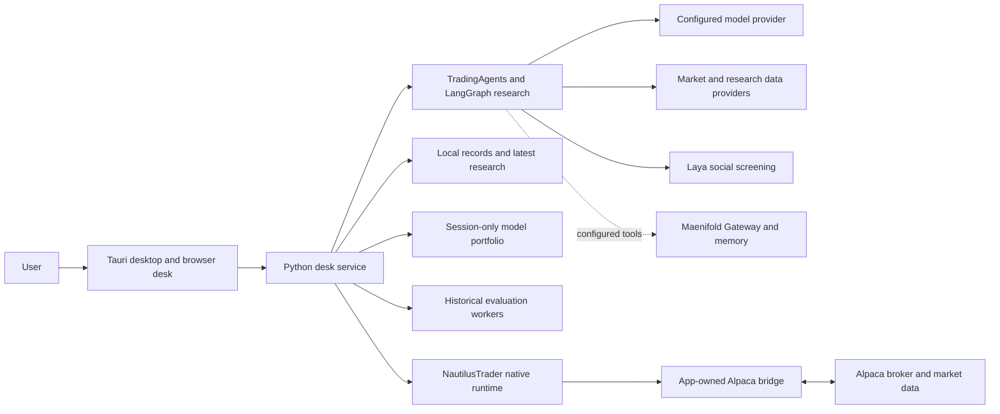

# TradingAgents trading desk

TradingAgents is a local desktop platform for market research, portfolio
analysis, historical simulation, and explicitly controlled order execution.
This fork combines the upstream TradingAgents research framework with a desktop
desk, NautilusTrader, an app-owned Alpaca bridge, and supporting data and memory
services. Research and modeled results help a person make decisions; they do
not grant authority to trade.

## How the platform fits together

The paths are not a required sequence. A person may inspect research, run an
isolated simulation, model a portfolio, or prepare a human order separately.
The desk collects exact terms and presents approval and submission as distinct
actions. Alpaca remains the source of broker-observed balances, holdings,
orders, and fills. A modeled allocation, research recommendation, saved draft,
or approval is not a broker fill.

| Component | Responsibility and boundary |
| --- | --- |
| Desktop shell and desk | Tauri manages the installed app and its owned processes. The browser interface presents the workspaces; Lightweight Charts and its drawing plugin render chart data. |
| Python desk service | Coordinates settings, research, evidence, proposals, baskets, approvals, calculations, local records, and commands to the native runtime. It is not a second broker. |
| TradingAgents, LangGraph, and LangChain | Run market, social, news, and fundamentals analysts, research debate, trader planning, and risk review. Their conclusions are advisory. |
| Model providers | The desk supports the Codex app-server adapter using existing sign-in and an OpenAI-compatible endpoint, including Unsloth. Saved settings determine the active provider and models. |
| Laya | An app-owned local Python router screens original social posts for relevance and sentiment, retaining provenance and uncertainty as research evidence. It does not authorize orders. Jev is an optional framework/CLI path, not a selectable fallback for the desk's Laya integration. |
| Maenifold | Gateway tools provide configured memory, graph, and structured reasoning capabilities. Durable Maenifold memory is separate from desk records; not every research call uses the Gateway. |
| NautilusTrader | A separate native runtime supplies the trading node, instruments, risk, orders, events, cache, accounting, and isolated historical evaluation. |
| Alpaca bridge and broker | App-owned data and execution clients connect Nautilus interfaces to Alpaca REST and trading updates. Alpaca supplies broker account and market observations. Supported integration is not proof that every order type has been executed successfully. |
| Data providers | Supported paths include Alpaca, Yahoo Finance/yfinance, SEC EDGAR, and optional Alpha Vantage, FRED, Polymarket, Reddit, and StockTwits sources. Availability depends on configuration, credentials, and provider access. |
| Local storage | SQLite and artifacts retain settings and authored records, including lists, notes, rules, drafts, and baskets. Research storage keeps only the latest result per ticker; a new cycle replaces that ticker's previous result. The desk does not maintain a competing research replay ledger or checkpoint-based resume history. |
| Evaluation workers and Optuna | Existing workers support historical simulation, chart and scan calculations, and strategy experiments; Optuna supports optional optimization. Results are hypothetical, not broker outcomes. |

## Use the desk

- **Dashboard and Markets** show account observations, watchlists, stock selection, discovery, charts, and instrument details.
- **Research** configures and monitors batches and presents saved conclusions, reports, debate, sources, and activity.
- **Portfolio** separates actual observed positions and performance from a session-only joint model proposal. The proposal uses eligible latest research and cached dated prices, separate model capital, and deterministic whole-share sizing.
- **Orders** holds human drafts and baskets. Review exact terms, approve each order, and submit separately. A basket is not an atomic broker transaction.
- **Strategy lab** evaluates saved plans and strategies against retained historical data with explicit assumptions.
- **Journal, Alerts, Workflows, and Settings** support decisions and outcomes, attention rules, research workflow configuration, and operations.

See the [desk reference](docs/desk-reference.md) for workflows, providers, data
boundaries, source paths, and detailed operations. See the [local desk guide](docs/local-desk-guide.md)
for the installed environment, recovery, and recorded acceptance evidence. For UI
design review and the planned workspace redesign, see the [UI design critique](docs/ui-design-critique.md),
[UI redesign blueprint (v3)](docs/ui-redesign-blueprint.md), and
[professional trader audit](docs/ui-redesign-trader-audit.md). Engine data the UI
does not yet show is ranked in [missed UI opportunities](docs/ui-missed-opportunities-nautilus.md).

## Start and operate

On Windows, open the installed TradingAgents desktop or Start menu shortcut.
The installed app serves `http://127.0.0.1:8098/` and uses its private production
profile under `%USERPROFILE%\.cache\trader\production`. The tray shows a status line
and provides Open, Restart, Check for updates, Open logs, and Quit. Refer to the local guide
for verified behavior and recovery; do not assume every tray operation or broker
order type has been accepted in every environment.

For isolated development, run `.\Start-TradingDesk-Dev.cmd` from the
checkout. It uses port 8099 and `%USERPROFILE%\.cache\trader\development`,
separate from production data and credentials. The repository's
`Start-TradingDesk.cmd` opens the installed production app. Desktop credentials
use the operating system's credential store (Windows Credential Manager or macOS Keychain), managed through Settings, with separate production and
development namespaces; do not put secrets in served assets or backups. macOS 26+ on Apple Silicon is a packaging target that still needs verification on a Mac; the verified paths in this guide are Windows.

Normal releases update the app and launcher while preserving installed private
runtimes. Full dependency setup is a separate operation. See the
[packaging guide](packaging/README.md), [contributor instructions](AGENTS.md),
and [source reference](docs/desk-reference.md#source-map).

## Project origins

This repository extends [TauricResearch/TradingAgents](https://github.com/TauricResearch/TradingAgents).
The browser desk and integrations described here are specific to this fork. See
the [license](LICENSE) and the notices under `tradingagents/web/static/vendor/` for their respective terms.
