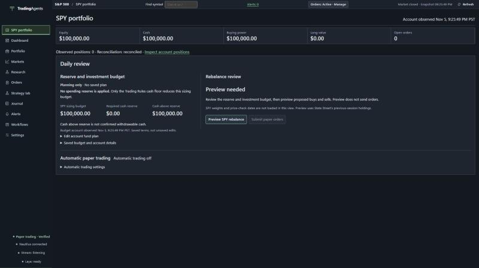
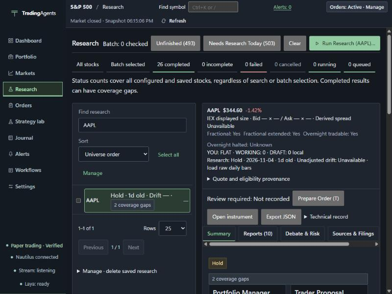
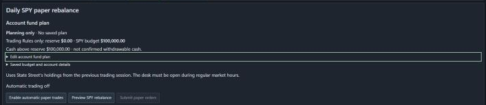
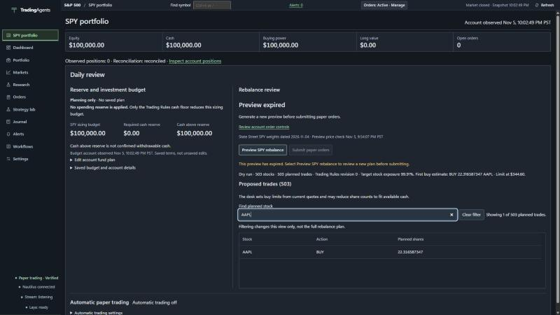
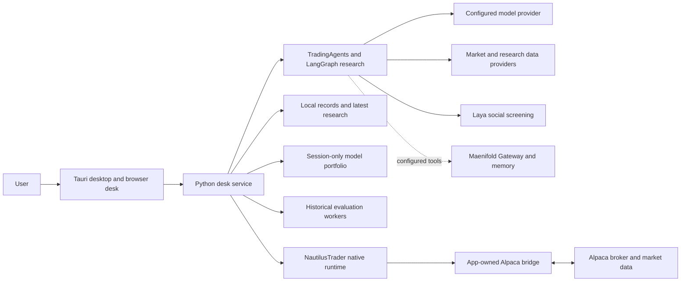

# TradingAgents trading desk

Manage your index portfolio. Know the budget. Review the next rebalance.

TradingAgents is a local personal index-management desk. Its first shipping
priority is the complete SPY stock-replication journey: account and reserves,
investment budget and dated holdings, rebalance review, separately authorized
execution, and reconciled outcomes. Research, charts, simulations and other trading
tools support that purpose. A working rebalance alone does not prove SPY return parity.

[Start the desk](#start-the-desk) · [Platform reference](docs/platform-reference.md) · [Local operating guide](docs/local-desk-guide.md)

## Find the next useful action

| I want to… | Open | What to do |
| --- | --- | --- |
| Start my daily index review | **SPY portfolio** | Check the account observation, balances, reserves and SPY budget, then inspect the rebalance. |
| Find and inspect a stock | **Markets** | Search the universe or a watchlist, then open the stock's chart and details. |
| Understand a saved conclusion | **Research** | Select the stock, read its Summary, then inspect Reports or Sources & Filings. |
| Review my account | **Portfolio → Positions** | Check observed holdings, cash and pending exposure. |
| Explore an allocation | **Portfolio → Allocations** or **Model proposal** | Set a historical allocation, or model a separate portfolio from saved research and dated prices. |
| Review an S&P 500 stock rebalance | **SPY portfolio** | Review the account fund plan and the proposed stock trades. Orders → SPY Rebalance remains an alternate entry. |
| Prepare exact order terms | **Orders → Ticket & Blotter** or **Human Baskets** | Prepare drafts, review each order, approve exact terms and submit separately. |
| Compare results | **Portfolio → Performance** | Open a saved account-history interval; use Journal → Account History when one is needed. |

**SPY portfolio** is the daily starting point: opening the desk without a workspace
hash lands here, and the TradingAgents home link returns here. Dashboard, research,
charts, simulations and the other workspaces remain available as supporting tools.

*The daily entry at a real 1920 × 1080 viewport. Editing stays secondary; automatic trading is off in this dated capture.*

## Read the research, not just the rating

Search narrows the list. Select a stock to open its saved result; the checkbox
beside it belongs to the next research batch. Summary brings the decision and
supporting arguments together. Reports and Sources & Filings let you inspect why.

*Research review: inspect one saved stock without changing the research batch.*

A completed result can still have coverage gaps. The desk keeps the latest result
per ticker; a new research cycle replaces that ticker's previous result.

## Inspect the whole rebalance, then find one stock

SPY Rebalance turns loaded SPY fund holdings weights into a reviewable stock plan.
An account fund plan can reserve cash for spending and other authored needs.
Review the reserve and SPY budget first. Open **Edit account fund plan** to change
its terms, or **Saved budget and account details** for the full breakdown.

*Review first, edit when needed. This detail capture comes from the real 1920 × 1080 desk.*

Use **Find planned stock** to inspect a constituent without changing the full plan.
An expired preview remains readable and asks you to generate a new one.

*Plan review: the lookup shows one matching stock while the full plan stays intact.*

Screenshots are real development views captured on 5 November 2026. Figures and
status belong to those captures. [Image notes](docs/images/README.md) record their
source revisions and scope.

## Keep planning and trading distinct

Research and model portfolios help you decide; they do not place orders. Model
capital is separate from account cash, and model allocations use deterministic
whole-share sizing against dated prices. Human drafts and baskets hold exact terms.
Per-order approval and broker submission are separate actions. Standing automatic
paper-rebalance authority is a separate, explicit control.

See the [order and execution reference](docs/platform-reference.md#orders-approval-and-execution)
for eligibility, account bindings and broker behavior.

## Start the desk

### Installed desktop

On Windows, open TradingAgents from the desktop or Start menu shortcut.
The repository's `Start-TradingDesk.cmd` opens that installed executable too.
The app uses `http://127.0.0.1:8098/`; its tray provides Open, Restart,
Check for updates, Open logs and Quit.

### Isolated development

From the checkout, use `Start-TradingDesk-Dev.cmd`. Development uses port **8099**
and its own profile, separate from the installed app's production profile.
Do not start another instance when the development desk is already running.

Manage credentials through Settings and the operating system's credential store.
For launch, storage, recovery and verified environment details, use the
[local desk guide](docs/local-desk-guide.md). macOS on Apple Silicon is a packaging
target; the recorded local verification is on Windows.

## How the platform fits together

- **Tauri and the Python desk** provide the interface, local records and coordination.
- **TradingAgents, LangGraph and LangChain** run research roles through the configured
  model and data providers. **Laya** screens social posts; **Maenifold** holds durable memory.
- **NautilusTrader** is the trading engine. The app-owned **Alpaca bridge** supplies
  broker and market observations; this is not a second trading engine.
- **Historical evaluation workers and Optuna** support simulations and optional
  experiments. Their results remain separate from observed account performance.

Saved settings determine the active providers and tools. The
[platform reference](docs/platform-reference.md) covers data sources, integrations,
storage, supported profiles and the [source map](docs/platform-reference.md#source-map).

## Guides and development

| Guide | Use it for |
| --- | --- |
| [Platform reference](docs/platform-reference.md) | Workspaces, research, data, orders and implementation paths |
| [Local desk guide](docs/local-desk-guide.md) | Launch, storage, recovery and acceptance evidence |
| [Packaging](packaging/README.md) | App-only releases and private runtime preservation |
| [UI design direction](docs/ui-redesign-blueprint.md) | Workspace design and interaction structure |
| [Contributor instructions](AGENTS.md) | Local delivery, security and operating rules |
| [Dogfood loop](docs/dogfood-loop.md) | One-item improvement cycles, UI clarity and living documentation |

## Project origins

This repository extends [TauricResearch/TradingAgents](https://github.com/TauricResearch/TradingAgents).
The desktop desk and integrations described here are specific to this fork. See
the [license](LICENSE) and notices under `tradingagents/web/static/vendor/`.
