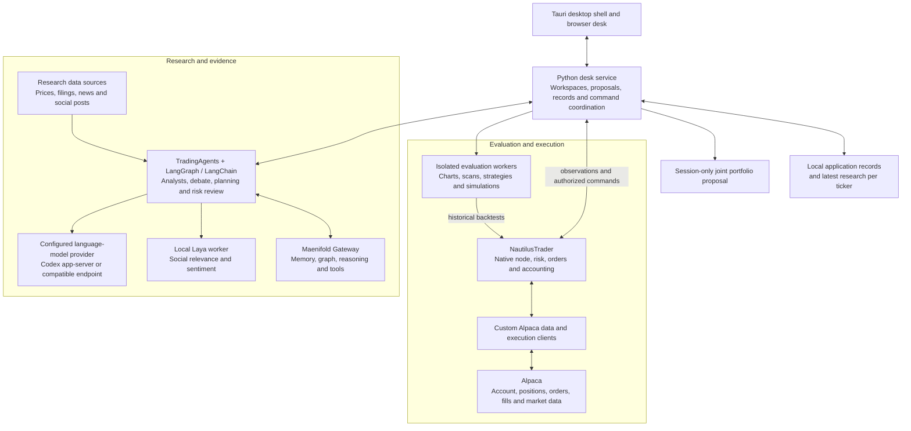

# TradingAgents integrated trading platform

A local desktop platform for agentic investment research, market analysis,
historical simulation, portfolio proposals, and human-controlled trading.
This fork builds on [TradingAgents](https://github.com/TauricResearch/TradingAgents)
and brings together **Laya, Maenifold, NautilusTrader, Alpaca, model providers,
and market-data services**. TradingAgents is the research framework within
the broader application; it is not the whole platform.

The platform helps you investigate an instrument, examine the evidence,
evaluate a hypothetical strategy or allocation, prepare exact order terms,
and monitor broker-observed outcomes. These are connected capabilities, not
a compulsory sequence. Research, simulation, a model proposal, a human basket,
approval, and broker submission remain distinct.

## Component map

The diagram groups responsibilities. Historical evaluation uses an isolated
Nautilus backtest engine; it does not send simulated orders to the broker node.
Market-data observations also feed the desk's charts and account views.

| Component | Responsibility here |
| --- | --- |
| **TradingAgents + LangGraph/LangChain** | Coordinate market, fundamentals, news and social analysts, research debate, trader planning and final risk review through validated workflows. Outputs are research recommendations. |
| **Model providers** | Supply language-model responses and tool calls. The desktop supports the installed, signed-in Codex app-server and a configured OpenAI-compatible endpoint, including an independently running Unsloth server. Saved settings determine the provider; installed software alone does not mean a model is loaded. |
| **Laya** | Runs an app-owned local Python worker to classify original social posts for relevance and bullish, bearish or neutral stance. Preserves coverage, raw results and uncertainty as evidence. It is not the main research model or an order-approval service. |
| **Maenifold** | Supplies schema-discovered Gateway tools, related-context retrieval, durable memory, concept graphs and structured reasoning. It is a separate service, not a transport for every model or data request. |
| **NautilusTrader** | Supplies the native trading node, instruments, risk checks, order/event handling, cache, accounting and historical backtest engine. The native runtime is separate from the desk runtime. |
| **Custom Alpaca bridge** | Connects Nautilus interfaces to Alpaca REST and trading updates through this app's data and execution clients. This integration is maintained in this fork. |
| **Alpaca** | Supplies broker-observed account balances, buying power, holdings, orders and fills, plus entitled market data. Local records do not replace broker state. |
| **Desk service** | Connects research, portfolio modeling, human drafts/baskets, exact-term review, approvals, native commands, settings and saved records. |
| **Desktop and chart UI** | Tauri manages the installed app and its owned processes. The browser desk presents workflows; Lightweight Charts and its drawing plugin render supplied data. |
| **Data providers** | Supported paths include Alpaca, Yahoo Finance/yfinance, SEC EDGAR, Alpha Vantage, FRED, Polymarket, Reddit and StockTwits. Configuration, credentials and provider access determine availability. |
| **Evaluation workers / Optuna** | Run isolated chart, scan and strategy calculations and historical scenarios. Optimization depends on the compatible Optuna dependency being available. |
| **Local storage** | Retains settings, authored lists/rules/notes, drafts and baskets, plus a separate disposable cache of the latest research per ticker. Maenifold owns long-term research memory. |

Jev remains an optional framework/CLI social-screening path. The desktop injects
local Laya; Jev is not its selectable fallback.

## What you can do

| Job | Workspace and result |
| --- | --- |
| Orient and discover | Dashboard and Markets show account observations, watchlists, a configured universe, screens, saved scans, charts and instrument details. |
| Research | Research configures batches and shows progress, conclusions, analyst reports, debate, sources and activity. Workflows configures validated research graphs and prompts. |
| Evaluate | Strategy lab runs saved-plan simulations and strategy experiments against qualified historical inputs with explicit assumptions. Results are hypothetical. |
| Model an allocation | Portfolio → Model proposal makes one joint deep-model synthesis of eligible latest research and cached dated prices. Separate model capital and deterministic whole-share sizing produce a session-only allocation. |
| Manage the portfolio | Portfolio shows broker-observed positions and performance where retained observations support it. Journal relates saved decisions and available outcomes. |
| Prepare and execute | Orders holds human drafts and baskets. Review exact terms, approve each order, then submit separately. Cancel and replace are separate explicit actions. |
| Monitor and configure | Alerts exposes occurrences, rules and delivery status. Settings manages accounts, providers, trading rules, integrations and diagnostics. |

The inspected instrument and the research batch selection are independent.
Opening a stock does not silently add it to a research run. Dashboard and Markets keep the research action beside the batch selection.
Review the exact symbols and settings before starting.

### Data and authority boundaries

- A research recommendation is advisory. A model portfolio is not actual holdings.
- A human basket creates linked drafts; its legs can fill separately.
- Approval binds exact terms and does not submit an order.
- Historical simulations and chart calculations do not establish broker fills
  or future performance.
- A new research cycle replaces that ticker's previous result. The desk does
  not import historical research, resume interrupted research, or persist a
  competing research replay ledger or LangGraph checkpoint history.
- Saved settings, authored records and broker approval semantics are separate
  from disposable research. Missing or stale evidence stays explicit.

## Start the desktop app

On Windows, use the installed TradingAgents desktop or Start menu shortcut.
The repository's `Start-TradingDesk.cmd` opens that installed app too.

| Environment | Address | Profile and runtime |
| --- | --- | --- |
| Installed production | `http://127.0.0.1:8098/` | Private profile at `%USERPROFILE%\.cache\trader\production`; installed desk and native runtimes |
| Source development | `http://127.0.0.1:8099/` | Separate `%USERPROFILE%\.cache\trader\development`; checkout environments |

For development, use `rtk proxy .\Start-TradingDesk-Dev.cmd`. Do not point
development at production stores or credentials. Desktop secrets use Windows
Credential Manager or macOS Keychain with separate profile namespaces.

Windows x64 is the installed deployment described by the local guide. Packaging
also targets Apple Silicon on macOS 26 or later; matching-host build and runtime
verification are still required. A clone is not a complete installation.

## Documentation

- [User workflows](docs/user-workflows.md): real user stories, screens, handoffs
  and the distinction between research, modeling, simulation and execution.
- [Platform reference](docs/platform-reference.md): workspaces, capability boundaries,
  research/data behavior, simulations, trading and source map.
- [Local operating guide](docs/local-desk-guide.md): launch, profiles, credentials,
  recovery, API reads and observed acceptance limits.
- [Laya social review](docs/laya-validation.md): evaluate saved classifications
  against independent human labels without running inference.
- [Packaging](packaging/README.md): app-only releases versus full dependency setup.
- [Contributor instructions](AGENTS.md): working rules for this checkout.
- [Local issues](docs/issues): tracked delivery work and its evidence.
- [Historical product requirements](docs/tradingagents-build-roadmap.md):
  retained scope reference; current instructions and implemented source take precedence.

## Source and attribution

This repository extends the upstream TradingAgents research framework. The desktop
application, service, Nautilus/Alpaca bridge and workflows described here are
specific to this fork. See [LICENSE](LICENSE) and the notices alongside vendored
components. The [source map](docs/platform-reference.md#source-map) links each
responsibility to its implementation.

Documentation describes implemented capabilities and their limits. It does not
certify every provider, device, order type or broker lifecycle as exercised.
