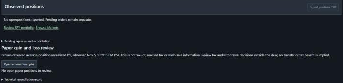

# Platform reference

Printer is the complete index-management desk. TradingAgents is the research
component described below. Compatibility package names, executable and app IDs,
Windows install/upgrade bindings, profiles and credential namespaces retain their
existing names; display branding does not migrate saved data.

Use the [root README](../README.md) for the component map and
[local operating guide](local-desk-guide.md) for deployment and recovery.
This reference describes the current source capability, not an acceptance log.

## Primary daily workspace

**SPY portfolio** (`#spy`) is first in the sidebar and opens when the desk URL has
no recognized workspace hash. The brand/home link returns there. Existing explicit
routes, including Dashboard (`#overview`) and Orders (`#orders`), remain available.

The page reuses the account balance strip and existing fund-plan/rebalance controls.
It shows the account observation time, coverage-qualified position count and
connected-state reconciliation status; **Inspect account positions** opens supporting
account views. The natural-height Daily review places the sourced reserve and
investment budget beside manual rebalance review. No spending reserve is applied
when the plan is absent or planning-only; the Trading Rules cash floor still applies.
Automatic trading status stays visible, with its authority control under
**Automatic trading settings**. Preview is the primary review action, not permission
to trade. The preview shows its returned SPY weights date and price-check time;
without a preview those dates are explicitly not loaded in this view. Portfolio's **Open account fund plan** opens the primary SPY editor directly.
Orders → SPY Rebalance remains an alternate entry to the same in-session plan and
preview. Known account-wide submission exceptions are shown in SPY, outside disclosures,
and additionally disable Submit. They reuse the account checks, not human-proposal
approval or the ticket ready count. **Review account order controls** opens
Orders management and focuses its account controls; ordinary updates retain that
pane by Orders tab. An empty exception list does not establish a complete SPY preflight pass.
The server still checks freshness, commitments and exact preview bindings.
SPY execution requests the existing native quote/account refresh before deriving
its next bounded LIMIT, outside the maintenance lock. It then rereads the run and
rechecks account/session, policy, fund binding, cash and holdings before existing
exact admission and one-shot transport. A refresh does not prove a new exchange
event or an acceptable spread; existing source-age and applied rules still govern.
Authoritative full-fill progress requests one post-fill account observation and
wakes the existing single-step executor on run/command/account progress. The
post-fill observation must still start after the fill and match expected holdings
before another leg; partial/unknown outcomes do not advance. Normal polling is a
fallback, not a parallel-order path. These mechanics require a loaded backend
revision; health exposes startup source hashes for the desk and native worker.
Broker fill-driven acceptance remains unobserved until an authorized real run.

Native account startup waits for data-client asset metadata and initial instrument
registration before importing observed holdings. Fill reconciliation keeps exact
execution identity, quantities, prices and fees, while accepting an Alpaca fill
timestamp's nearest-microsecond representation across activity and stream sources.
Original source timestamps remain unchanged; other timestamp differences block import.
For a simple accepted, partially filled, filled or expired command, complete current broker/native order and exact fill
proof can supersede covered older receipts and release their retained commitment.
Restart recovery fetches unresolved expired parents even without an open order or
holding; exact native expiry and fill coverage are required, not inferred from
absence. Expired commands remain expired and cannot be revived as accepted.
The same proof updates a lagging simple command's lifecycle, cumulative fill and
execution IDs before run holdings are checked; stream delivery is not required.
Recovery matches proven fills within append-only command IDs and requires matching
delivery receipts confirmed in the current native epoch, including superseded receipts.
Account refresh publishes fill rows with their converted fee provenance and complete
parent observations, so in-flight collection does not strip proof from unchanged fills.
Pending native report collection reports **refreshing** when it has no substantive
comparison/proof failure. This defers admission and durable approval updates; it
does not authorize admission using a previous balance. Real gaps, stale sources,
unknown outcomes and conflicts remain blocking. Each state response uses one
captured observation for account, native, health and command status. A completed
observation rechecks durable command recovery rather than retaining a refresh-only
failure until a later background pass.
Broker collection and native application hold one observation lock, so a queued stream
update cannot invalidate a generation between those phases. A crossed update remains
an incomplete, retryable observation, not a permanent import failure. SPY requests a
refresh when current reconciliation, the existing account-age limit or filled-command
proof requires one, rather than forcing another collection for every ready leg.
Conflicting or uncovered receipts remain blocking; historical events are not replayed.
For an interrupted same-session reviewed run, **Preview remaining trades** retains
the original unprocessed legs instead of recalculating targets. Attached accepted,
partially filled or filled commands require current native proof and matching
holdings; they remain tracked and are not submitted again. The remaining trades
require a fresh preview and separate **Submit paper orders**, with the current
account, connection, fund plan, Trading Rules and session checks. Previewing does
not send orders or change the blocked run.
Submitting waits for an in-progress current observation outside the maintenance
lock, then pins that completed snapshot while rechecking and queueing the preview.
A bounded pre-queue reconciliation wait returns a typed not-queued response and
retains the still-current preview for an explicit retry; unknown outcomes do not.
An attached command explicitly resolved as never dispatched by the versioned local
transport boundary stays in the reviewed remainder; no fill or broker retry is inferred.
Stock-local quote, freshness and instrument failures defer that leg with its exact
terms and reason; they do not prevent review/submission of other eligible stocks.
Deferred trades are separate from planned/submitted counts and persist for a fresh
**Preview remaining trades** after the pass. Quote and rule checks run again before
each new order; account-wide risk, funding, session and reconciliation blockers remain
blocking for the whole run. Existing proven working orders keep their reservations.

Independent SPY buys use one sealed batch authority, not acknowledgment-driven
per-stock admission. Preview freezes each equity DAY LIMIT quantity and price
against observed cash after existing commitments and the required fund/policy
reserve; pending sale proceeds are never credited. One SQLite transaction
reviews the combined portfolio and reserves every eligible independent buy,
acquiring each exact dispatch intent together. Consumed batch approvals are not
revoked by that batch's own acknowledgments, fills or account-version changes.
The native adapter queues independent orders at the existing native submit rate
and paces against the broker's reported remaining/reset quota when supplied,
without waiting for earlier HTTP responses, fills or account-history polls.
Unchanged, fully filled plain-equity parent observations are reused only inside
the current native process when fresh activity identities and quantities still
match all retained native executions; normal exact fill conversion/proof remains
mandatory. This avoids refetching every closed parent on every account poll.

The reserved envelope is not a last-good-balance fallback. Current native
executions must retain exact account, instrument, order, execution, timestamp,
quantity, price and USD fee proof. Current broker cash/holdings must be exact
owned-execution prefixes of the reservation baseline; USD cash is compared at
cent precision. The full original obligation stays reserved even after price
improvements or sales. External changes, genuine unknown outcomes, conflicts,
native import failures, changed terms/policy/fund authority, stale observations,
reserve breaches and session expiry stop unsent orders. Current instrument and
quote/rule checks still defer only the affected stock before transport.

The UI separates admitted, native-queued, transport-started, broker-response,
working, filled, expired, rejected, never-sent and unknown counts. Native queueing
is not broker submission, and **submitted** never means all orders filled.
No native request or ambiguous transport attempt is automatically replayed.
Restart/workspace recovery blocks retained batch authority, preserves uncertain
commitments and requires fresh review. Same-session remainder review excludes
proven working/filled members and requires exact no-send or terminal residual
proof for a new attempt. A later-session preview uses current weights, prices,
broker holdings and pending obligations, never the prior batch's quantities.

Navigation changes no plan terms or trading authority. Unchanged Markets search,
named Markets/SPY disclosures and SPY review buttons retain their node identity
across same-context ordinary updates. Native disclosure expanded state and focus
remain available to structured browser controls; changed semantics still replace
controls. Settings category tabs and policy fields/actions use the same unchanged
node retention, bounded by category and investor revision. Bid/ask spread and
Quote freshness state/session choices use labeled native radio groups so
structured browser clicks can select them; draft choices do not save policy.
This does not pause polling or relax review/submission guards. This entry is not
acceptance of the full execution/reconciliation journey or SPY return parity.

## Fixed-portfolio hindsight evaluation

The existing fixed-portfolio action uses the archived allocation, retained raw
daily bars and dated corporate-action receipts. It runs through the existing
native simulation executor and saves the immutable specification and returned
result in the simulation index. Open it from saved simulations to read combined
equity, cash, historical whole-share entries, ending shares and dated actions.
Distributions remain cash; there is no reinvestment, cash interest or rebalancing.
This is hindsight allocation testing, not historical research or broker performance.
Missing required inputs stop calculation; this path does not fabricate a result.
Source implementation does not establish that a saved native evaluation exists.

## Markets, charts and selection

The configured universe, named watchlists, broker holdings, inspected instrument
and research batch are different collections. Viewing a stock does not change
the batch. Discovery results outside the universe do not automatically become
research or trading targets.

Markets includes Watchlists, Universe, Screener and Saved scans. Batch selection and the research action stay together above the list.
Secondary filters and list-management controls remain in their disclosure.
Check the exact selection before confirming research.
Membership changes do not create holdings.

Yahoo discovery uses explicit provider requests and pagination. Saving criteria
does not run them; editing a draft does not change an earlier result. Provider
totals and complete market coverage can be unavailable. Yahoo discovery does not
establish Alpaca tradability or an IEX quote.

An instrument has Chart, Research, Options and Position views. The chart renderer
is Lightweight Charts; it does not fetch prices. App modules collect and qualify
inputs and run calculations separately.

### Chart and scan evidence

- Every history source has symbol, interval, feed, adjustment, capture time and
  coverage. Retained daily bars are not a current consolidated quote.
- MU/PM stock refresh observations include bounded `stock_snapshot_evidence`:
  allowlisted raw quote/trade fields, IEX/source/capture identity and normalization
  outcome/input/cache event times. This latest in-memory diagnostic changes no
  quote acceptance, freshness or fallback and contains no credentials/full payload.
  Valid stock bid/ask prices are losslessly padded to common native precision,
  matching the option-mapping pattern; an integer bid with a decimal ask must not
  be rejected solely for a representation-precision mismatch.
  It requires the updated native worker; absent fields in an older process are not
  evidence that the provider omitted data.
- Saved research inputs and separately collected market history remain distinct.
  Selecting a cache does not refresh it. Collection is an explicit action.
- Studies, formula revisions, comparison, drawings, source inspection and playback
  retain source identity. Unsupported or incompatible inputs stay unavailable.
- Derived minute aggregates are distinguished from provider coarse bars.
  Closed-bar, warmup, source-freshness and numerical-validity checks are separate.
- Saved declarative scans combine typed conditions and allowlisted formula
  expressions across qualified timeframes. They do not execute arbitrary scripts
  or Pine code.
- Scan definitions, exact revisions, membership selection, collection consent,
  budgets and historical cutoff are explicit. A later capture does not establish
  what was known at an earlier date.
- In-app scan scheduling requires separate opt-in. Editing/importing a definition
  does not enable its schedule, and stopped intervals are not backfilled.
- Formula/drawing-derived alerts retain their evidence. Saving a drawing is not
  itself an alert or an order.

## Research

TradingAgents supplies the analyst and deliberation roles. LangGraph executes the
validated workflow; LangChain-compatible adapters supply model messages and tools.
The default stages cover market, fundamentals, news and social analysis, bull/bear
debate, research management, trader planning and risk/portfolio review.

Workflows can edit graph connections, prompts and supported runtime limits.
Validation enforces registered nodes, required stages, joins and bounded debate
routing. This is research configuration, not arbitrary code execution or a
second trading engine. Runs use their captured workflow/settings revision.

In Research, search and status filters narrow the list; selecting a ticker opens
its saved result. A row checkbox changes the next research batch, not the inspected
stock. Status counts cover unique configured and saved stocks before search, batch
filtering or pagination. A completed result can have coverage gaps: completion and
source coverage are separate. Inspect Summary, Reports, Debate & Risk, Sources &
Filings and Activity for the saved decision and its evidence.

### Model providers and tools

The desktop's Codex provider uses the installed, signed-in Codex app-server.
Its adapter returns function calls to the app-controlled research workflow.
It does not give a research model unrestricted computer or broker access.

The OpenAI-compatible provider uses the configured endpoint and loaded model.
Unsloth is one possible compatible server; launching it does not load a model.
The framework has other provider adapters, including a distinct Responses API
path named `chatgpt`. Do not equate that path with the desktop's `codex`
app-server provider. Read saved settings to establish the active selection.

The Maenifold integration discovers Gateway command schemas and applies allowed
tool boundaries. Configured agents can use context retrieval, memory reads,
concept graphs and SequentialThinking. Not every model call, data request or
local classifier pass travels through Maenifold. The desk can host its own
Maenifold instance on a separate port and data root from Settings.

### Research data and evidence

Supported source paths include Yahoo/yfinance, SEC EDGAR, Alpha Vantage, FRED,
Polymarket, Reddit, StockTwits and selected Alpaca observations. The router and
saved configuration determine which sources are attempted. Source support is
not a promise of entitlement, completeness or current availability.

Research keeps reports, conclusions, debate, source references and completion
gaps for the latest result. Source, Gateway and social-screening receipts cover
different boundaries. Their counts must not be added as if each were a unique
network call. Hidden SDK/provider attempts remain unknown.

Valid empty data differs from failed acquisition. Captured raw inputs can
contain records later excluded by date/relevance filters. Successful capture
does not prove evidence quality, and a tool invocation does not prove the model
used every returned field. Oversized, unsupported or unsafe captures remain gaps;
they must not be silently replaced by fabricated content.

Rate-limit and transient-source retries use configured bounded backoff.
FRED and Reddit no longer have a universal one-retry rule. A long retry delay
can defer work; it does not authorize an unbounded wait or automatic broker retry.

### Laya and social screening

Local Laya is disabled unless the application starts with
`TRADINGAGENTS_LAYA=1`. Disabled mode reports its status without loading a model
worker, and inference requests fail explicitly rather than returning a screening
result. Device changes preserve this opt-in.

When enabled, the desktop injects an app-owned local Laya Python worker, using the pinned
multilingual model and typed per-post relevance/stance questions. Several posts
can share a batch while retaining separate questions and original inputs.
The integration records model identity, raw outputs, token coverage, probabilities,
policy and uncertainty.

Missing Gateway grades in Laya 0.4.14 do not by themselves make a result uncertain.
The policy evaluates valid probabilities and a unique qualifying stance.
Unclear, unscreened and neutral are different outcomes. Source author tags, such
as StockTwits Bullish/Bearish tags, have different denominators and are not
classifier output or independent ground truth.

CPU/GPU support and fallback depend on the installed runtime. Ready means weights
loaded, not successful inference or calibrated quality. Cancellation/timeout can
terminate the owned worker; an interrupted pass has no accepted late result.
A later request uses a fresh worker. Neither screening nor its absence grants
order authority.

Jev remains an optional framework/CLI screening path. It is not the desk's
selectable fallback for Laya. See [Laya social review](laya-validation.md) for the
file-only human-label workflow and its limits.

### Latest research and interrupted cycles

The desk retains only the latest result per ticker in its application-side
research cache. Starting the next cycle for a ticker replaces its previous
research. Other tickers keep their latest result.

Research is not imported from a desk history folder. Interrupted runs become
failed/interrupted latest results with explicit gaps; start a new cycle rather
than resuming a checkpoint. The desk does not retain LangGraph checkpoints or a
competing long-term research decision log. Maenifold owns durable research memory.

Authored settings, watchlists, rules, notes, chart definitions, drafts and baskets
have separate retention. A saved record's old research reference may become
unavailable; do not silently substitute today's report.

## Portfolio and proposal types

| Object | Inputs and meaning | Authority and lifetime |
| --- | --- | --- |
| Research recommendation | One ticker's analyst evidence and model review | Advisory; latest-per-ticker retention |
| Joint model portfolio | Eligible latest research, cached dated prices and separate model capital | Session-only hypothetical allocation |
| Human basket | User-authored target quantities/weights and explicit terms | Saved linked local drafts; not atomic execution |
| Order draft | Exact instrument, side, quantity, type, prices and duration | Saved preparation; no approval or submission |
| Approved order | Reviewed exact terms and required current context | Still needs separate submission |
| Actual portfolio | Broker-observed balances, positions, orders and fills | Broker state; not replaced by local modeling |

Portfolio has Positions, Allocations, Model proposal and Performance. Positions
shows observed holdings and pending exposure. When verified holdings are empty,
**Review SPY portfolio** returns to the daily review; **Browse Markets** remains
available for optional research. Navigation does not generate a preview or change
authority. **Open account fund plan** opens the editor in SPY portfolio. Allocations contains fixed-weight historical scenarios;
loading preset weights does not run a simulation. Holdings as-of dates do not
establish historical publication or availability at the scenario start.



The empty-position handoff returns to SPY review without starting a preview or trade.
See [image provenance](images/README.md) for the dated capture and limits.

Portfolio → Model proposal invokes one joint deep-model synthesis. It starts with model
cash rather than copying actual holdings. Deterministic sizing floors each
allocation to whole shares using the supplied dated prices and reports residual
cash. Invalid/omitted allocations and failed inputs are not silently invented
or replaced. It neither creates a human basket nor authorizes orders.

Portfolio performance uses retained observations and declared methods. Missing
account history, fees or complete event coverage stays unavailable. Without a saved
interval, **Open account history to compare performance** opens Journal → Account
History rather than presenting failed-looking metrics. Native cache tables, broker
performance and hypothetical scenarios are different reports.

The model's **Model capital (USD)** and **Prices and research as of** inputs sit
below the Portfolio header with **Model portfolio**. Compatible normal renders
keep an actively edited native date connected, including partial dates; navigation,
forced renders or changed model context retain the normal replacement behavior.

## Orders, approval and execution

Orders groups controls into Ticket & Blotter, Fills & Fees, Human Baskets,
SPY Rebalance and Option Instructions. The top-bar **Orders: Active · Manage**
(or paused equivalent) selects Ticket & Blotter and focuses account order controls;
it is navigation, not a gate change.

The SPY preview groups **Find planned stock**, **Clear filter** and the matching-row
count in a compact wrapping toolbar directly above the complete trade table.
Filtering changes displayed rows only; the full plan and its authority bindings
stay unchanged. Natural expiry keeps the
preview readable, disables submission and asks for a new **Preview**.

A latest run with blocked status is labelled **Latest rebalance blocked**, with its
actual session, reason and progress warning-styled. It takes priority over routine
preview guidance, but not busy, in-progress, unavailable-account or account-condition
messages. **Review account order controls** opens the existing Orders evidence and
recovery workspace. A new preview does not resolve the previous run. This is
source-confirmed presentation; no blocked run was induced or live-accepted. Preview,
submission eligibility and standing authority retain their separate guards.

After a failed manual SPY submit, the client revokes that preview’s submit token
but retains a still-current full plan and filter. Its session-only failed-submit
response keeps the actual error separate from preview invalidation. An HTTP error response is
labelled **Service returned an error**; an unconfirmed response is labelled
**Check submission outcome**. Neither proves the rebalance was not queued: inspect
the latest rebalance, orders and fills before another preview or attempt. The
service can fail while building its response after queuing a run. Existing
higher-priority run/account status and guidance remain. These error branches are
source-reviewed, not live broker-error acceptance; no automatic retry or change to
server admission or standing authority is added.

The path is:

```text
Human terms or selected research
  → draft / human basket
  → preview and exact review
  → per-order approval
  → separate submission and admission checks
  → Nautilus native command
  → custom Alpaca client
  → broker observations and reconciliation
```

A model's trader or portfolio-manager role is not broker authority. Approval
does not dispatch a command. Terms, account identity, policy, source freshness,
commitments and current eligibility can invalidate readiness. Baskets create
linked proposals; each leg needs its own review/approval and can fill separately.

The bridge implements app-owned Nautilus market-data and execution clients using
Alpaca REST and trading updates. Native memory cache is not durable execution
proof. Broker observations and application commands are reconciled; an unknown
submission outcome must not be treated as permission to submit again.

### Supported source profiles and limits

| Area | Implemented boundary |
| --- | --- |
| Equity orders | App/native capability and current broker eligibility determine available order types, prices, durations and session choices; do not assume the old limit-only paper profile. |
| Cancel/replace | Explicit separate actions against eligible observed orders; replacement requires renewed review of changed terms. Acknowledgment is not final cancellation. |
| Trailing protection and linked exits | Dedicated controls and declared ownership/remaining-quantity rules; not an implicit consequence of a research recommendation. |
| Selected options | Retained contract identity, feed, account permissions, whole contracts and supported premium-order profile are required. Underlying research is not an option recommendation. |
| Option packages | Separate long-only and bounded-risk profiles have explicit leg, ratio, expiry, price, collateral and account requirements. They do not imply unrestricted short-option support. |
| Exercise / do not exercise | Separate exact-instruction preview, review, approval and submission; not ordinary order approval. |
| Unsupported observations | Remain inspectable with limitations. Missing parent/leg economics, exposure or commitments must not become zero or a fabricated equity order. |

These are source capabilities, not proof of exercised broker/native acceptance
for every profile. The live account, current permissions and readiness checks
control actual availability. Paper fills also do not establish live execution.

### Account fund plans and paper gain/loss review

SPY portfolio (also available through Orders → SPY Rebalance) includes a saved
plan for the currently observed USD paper account. Monthly net withdrawals from that account, reserve coverage in months,
a manual tax provision and a trading cushion are explicit nullable terms. Blank
is unknown; zero must be authored. Planning-only plans do not constrain sizing.
Saving an applied reserve requires all four terms. The editor explains missing
terms and disables Save; the service rejects incomplete active saves before
mutation. Planning-only terms can remain unknown. Existing incomplete active
records remain readable and block sizing until resolved. Other saved account
plans are inspection-only, without unobserved balances or consolidated fund totals.

The SPY page leads with the required reserve, investable SPY budget and cash above
reserve. **Edit account fund plan** opens the existing inputs and save/reload
controls; **Saved budget and account details** opens the full breakdown and source
record. Unsaved changes, conflicts, budget errors and positive shortfalls stay
visible outside those disclosures. Portfolio's **Open account fund plan** opens
the editor directly. Desktop design and visual checks target 1920 × 1080 or higher.

The authored reserve is monthly withdrawals × months + tax provision + cushion.
The SPY sizing reserve is the greater of that sum and the enabled Trading Rules
percentage cash floor. It is not both added together. SPY weights apply to the
remaining investable sleeve, with existing gross/single-stock caps and quantity
precision. Working or unknown commitments make spendable-cash estimates
unavailable. Observed cash is not a settled or withdrawable balance.

Saving identical normalized terms and status preserves the existing preview,
filter, original expiry and authority checks; the editor reports that the plan is
unchanged. Save and no-op preservation are source-confirmed, not live saved-plan
acceptance in the current empty-plan check.

Material plan changes pause automatic paper trading, invalidate the old preview
and block further run dispatch. Explicit re-enablement is required; already-sent
orders are not canceled. Plans and runs bind account, connection and revisions.
After a fill, continuation requires reconciled expected holdings and an account
fetch begun after that fill. Restore disables standing authority and invalidates
active runs. These are source safety boundaries, not broker-execution evidence.

Portfolio's paper gain/loss review uses broker-reported average-position
unrealized P&L. Prepare sell opens an ordinary unsaved ticket; exact quantity,
terms, approval and submission remain separate. It is not tax-lot selection,
realized tax profit/loss, household wash-sale clearance or transfer execution.
Existing qualified Performance comparisons remain price-only where stated;
no new consolidated fund or SPY total-return calculation is implied.

## Strategy lab and historical evaluation

Evaluation workers use retained qualified sources and Nautilus BacktestEngine
for saved-plan simulations and strategy experiments. Chart and scan calculations
share source/calculation infrastructure but are not broker execution.

A simulation declares capital, source identity, dates, fees, slippage and fill
assumptions. Synthetic ticks derived from bars are a modeling basis, not observed
tick/BBO liquidity. Incomplete prices, calendars or coverage remain explicit.
A simulation does not become a historical account reconstruction merely because
it shares a research date.

Strategies use validated declarative definitions and immutable revisions.
Experiments can use rolling/expanding training, validation and untouched
out-of-sample windows with explicit gaps and budgets. Optimization is available
only when the required compatible Optuna runtime is present. Do not infer it from
a menu label alone.

Runs, results, saved strategies and experiments are optional evaluation branches.
Neither simulation nor a joint portfolio proposal is a required stage before
preparing a manual order. Loading saved inputs does not run a simulation.

## Journal, alerts and configuration

Journal relates saved decisions, human notes, available outcomes and account
history. It does not restore replaced research or prove missing fills.

Alerts distinguishes rule definitions, observed occurrences and delivery.
Compound/watchlist conditions retain source identity; unavailable observations
are not false predicates. Acknowledgment does not necessarily rearm a rule.
Browser notification delivery requires browser permission and an active supported
surface; it is not an always-on external notification service.

Settings owns accounts, model selection, rules, integrations and diagnostics.
Credentials are stored in the desktop OS vault. Saving them does not reconnect
an active engine. Workspace preferences and drafts use revision-aware saves;
reload a concurrent change rather than silently overwriting it.

The browser workspace uses React for persistent component ownership and Material
UI for controls and layout. Its five-second read-only state poll updates data,
not the application root or workspace DOM. Each visited workspace keeps its own
mounted components and native scrolling; drafts, filters, selected records and
disclosures are local view state, not regenerated from a polling response.
Dashboard, Portfolio, Orders, Markets, Strategy Lab, Journal, Alerts and Settings keep their tab panels mounted
in separate bounded native scroll containers. Switching a short panel into view
does not shrink another panel's scroll range or reset its position.
Ordinary tables, including filing evidence, captured native reports, import
previews and chart-analysis readouts, use MIT-licensed MUI X Data Grid Community.
Column headers sort; the native column menu provides typed filtering, and the
toolbar provides quick search and column visibility. The grid owns pagination
over the complete loaded collection, not a pre-sliced visible page. Research and
Markets retain their full loaded stock lists; captured reports are not truncated.
Numeric and date sort/filter values are separate from exact displayed source
values and never rewrite order or allocation terms. Selection survives filtering;
selecting, sorting or filtering never runs research, approves or submits orders.
Saved watchlist/research scopes and authored column preferences remain distinct
from grid filtering. Yahoo discovery is genuinely server-paged: its native pager
requests fixed 25-row provider pages, and grid sorting/search/filtering cover only
the loaded page. Explicit provider-wide criteria and ranking are separate.
Charts, editors, narrative cards and expandable JSON/key-value evidence retain
their specialized controls; they are not ordinary data tables.
Saved proposals show a command's recorded outcome only when proposal ID, revision,
terms hash, account and instrument match exactly; never-dispatched records and
changed revisions remain reviewable. Filled, expired and working commands do not
become drafts merely because their authored proposal is still saved as a draft.
Native confirmation gaps remain separate from that recorded outcome.
Research activity reads retained attempts from each source, gateway and screening
evidence envelope, preserving the receipt category and exact contents.
The Journal's initial reporting read is independent of its pending indicator;
entering the loading state does not cancel the read. An ended SPY session's
recorded reason is labeled **Previous session ended**, not current account
blockage, and never renews its approval.
Research, calculations, configuration saves and order actions remain explicit
events, never mount or polling effects. A failed state read marks the connection
unconfirmed instead of enabling actions from the last successful snapshot.
Vite builds the source in `desktop/desk-ui` into local packaged static assets;
there is no runtime CDN, additional server or change to backend order authority.
Both normal and recovery-only startup serve that entry. The former workspace,
drawer and recovery renderers are retained as reference but are not loaded.
Lightweight Charts, drawing primitives, CodeMirror and Mermaid own only their
isolated chart/editor hosts; workspace controls and layout use Material UI.

## Source map

| Responsibility | Implementation |
| --- | --- |
| Desktop ownership and profiles | [main.rs](../desktop/src-tauri/src/main.rs), [backend.rs](../desktop/src-tauri/src/backend.rs) |
| HTTP/session boundary and coordination | [server.py](../tradingagents/web/server.py), [service.py](../tradingagents/web/service.py) |
| React UI, controls and layout | [desk-ui](../desktop/desk-ui), [built static assets](../tradingagents/web/static/desk-ui) |
| Specialty charts and workflow editors | [vendored libraries](../tradingagents/web/static/vendor), [workflow toolkit source](../desktop/workflow-ui) |
| Research graph and validation | [graph/setup.py](../tradingagents/graph/setup.py), [workflows.py](../tradingagents/workflows.py) |
| Provider selection and adapters | [factory.py](../tradingagents/llm_clients/factory.py), [chatgpt_client.py](../tradingagents/llm_clients/chatgpt_client.py), [openai_client.py](../tradingagents/llm_clients/openai_client.py) |
| Laya and social policy | [integrations/laya.py](../tradingagents/integrations/laya.py), [post_screen.py](../tradingagents/agents/post_screen.py) |
| Maenifold, desk-hosted instance and data routing | [integrations/maenifold.py](../tradingagents/integrations/maenifold.py), [dataflows/router.py](../tradingagents/dataflows/router.py) |
| Joint model allocation | [portfolio_model.py](../tradingagents/web/portfolio_model.py) |
| Drafts, baskets and exact review | [investor.py](../tradingagents/web/investor.py), [baskets.py](../tradingagents/web/baskets.py), [approval_review.py](../tradingagents/web/approval_review.py) |
| Account fund plans and paper SPY sizing | [fund_plans.py](../tradingagents/web/fund_plans.py), [spy_rebalance.py](../tradingagents/web/spy_rebalance.py) |
| Admission and command lifecycle | [admission.py](../tradingagents/web/admission.py), [execution_lifecycle.py](../tradingagents/web/execution_lifecycle.py) |
| Nautilus and Alpaca | [nautilus_worker.py](../tradingagents/web/nautilus_worker.py), [nautilus_runtime.py](../tradingagents/web/nautilus_runtime.py), [alpaca_readonly.py](../tradingagents/web/alpaca_readonly.py), [alpaca_stream.py](../tradingagents/web/alpaca_stream.py) |
| History, discovery and evaluation | [market_history.py](../tradingagents/web/market_history.py), [market_discovery.py](../tradingagents/web/market_discovery.py), [evaluation.py](../tradingagents/web/evaluation.py), [evaluation_worker.py](../tradingagents/web/evaluation_worker.py) |
| Records, latest research and recovery | [app_database.py](../tradingagents/web/app_database.py), [store.py](../tradingagents/web/store.py), [workspace.py](../tradingagents/web/workspace.py), [recovery.py](../tradingagents/web/recovery.py) |
| Credentials | [credentials.py](../tradingagents/credentials.py) |
| Runtime contract | [nautilus-v1-runtime-manifest.json](nautilus-v1-runtime-manifest.json) is a live source-development fallback, not an audit attachment. |
