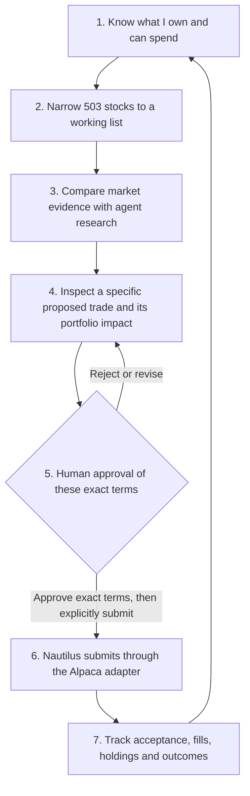
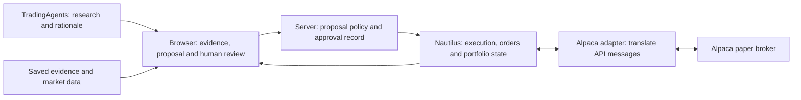
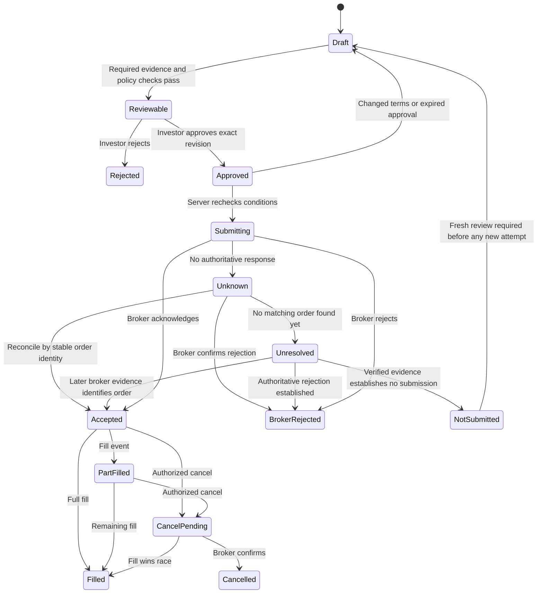

# TradingAgents: what remains before portfolio management

Historical requirements reference. This is not an inventory of implemented capability or current acceptance. Current instructions, README.md and docs/user-workflows.md take precedence.

## Current scope and specification correction — 18 October 2026

The user's direct instructions govern this document. The original audit suggestions were considered design inputs, not independent authority to add prerequisites. Later instructions reject mandatory investor questionnaires, invented submission barriers and the crash-recovery project. The 18 October request requires plain order status, the actual reasons a particular order cannot be submitted, functional Alpaca integration and exact per-order approval. No agent may approve or place trades, cancel/replace orders, or start research during this work.

Optional investor rules apply only when actually configured. An unset optional rule is disclosed as not configured; it is not silently enabled, disabled or replaced with an invented numerical default, and it does not block approval. Missing optional analytics, benchmark selection, technical age inputs and manually entered fee ceilings are not general trading prerequisites. Preserve real broker/account/instrument/order constraints, sufficient funds and holdings, applicable configured rules, exact single-use human approval and checks immediately before submission. An unavailable cost remains unknown, not zero. Approval validity follows exact terms, relevant changes and any configured lifetime; a mandatory manually chosen duration is not required.

Delivery evidence and runtime permission are separate. Independent review remains required for delivery; it is not a second approver in the investor's order workflow. Untested broker execution must be reported honestly, but lack of a development exercise is not a feature-disable switch. A status such as “not paused” must never imply that an order is ready. Show actual account/order blockers and the existing action that addresses each one.

The pre-correction document is retained at `evidence/order-readiness-20261018/spec-before.md`. Its dated observations and old scheduling/test machinery are historical, not instructions to reintroduce removed work. Provenance: direct user instructions in this chat, including refusal of policy/benchmark questions, no-replay/crash-project rejection, required Alpaca capability, feature freeze, and the 18 October order-readiness and specification-audit requests.

## User scope correction: no crash-recovery project

**USR-RECOVERY-NO-REPLAY-20261017.** Direct user instruction: “If the app crashes I don't want it replaying the order. I'd rather loose it and regenerate state from reality.” The subsequent user instruction rejects the invented crash scenario and orders its added code removed. Existing normal broker-first startup and no automatic order dispatch remain. No separate native-cache persistence, replay, restart-abandonment or crash-engineering project is required or deferred.

Preserve established SQLite application/history records, ordinary official Nautilus/Alpaca account/position/order/fill observations, actual broker-order visibility and the existing human-approval/trading restrictions. Remove additions made solely for the rejected theoretical scenario. This override supersedes conflicting recovery interpretations below; it authorizes no tests, verification, research or trades.

## User correction: trading capability is required

**USR-ALPACA-CAPABILITY-20261018.** The user clarified that the prohibition is on agents performing trades. It is not a requirement to disable the application's trading capability, make Alpaca endpoints inaccessible, or narrow the integration. The intended user-operated TradingAgents → Nautilus → Alpaca workflow remains required, with the existing human approval controls. Remove invented permanent execution refusals; do not replace them with new account/environment restrictions, artificial permission barriers or capability modes. Preserve the user's configured account and endpoints. Agents must not perform broker mutations or new research runs while completing this work. Earlier delivery-stage references to permanently disabled admission/transport, including the H03 correction boundary, do not satisfy this requirement and are superseded. Existing genuine account/term validation and per-order human approval remain required.

**USR-ORDER-BLOCK-DEFAULT-20261018.** Direct user instruction: clear the current account-wide new-order block and make the default unblocked so it does not return. Preserve per-order human approval. Keep the user-operated block control and honor an explicit future choice to block; normal reload/restart must retain the saved choice. Missing-value defaults must not silently restore the account-wide block. This instruction authorizes the current unblock through the existing control, but no order submission, cancellation, replacement, new research or per-order approval. Verify the completed source batch in the actual browser. This supersedes earlier interpretations requiring the global block to remain active by default.

Assessment: 16 October 2026. Revised into a delivery specification for a professional investor managing their own money. Scope: local browser UI, TradingAgents research, Nautilus engine and Alpaca paper account. This is an engineering specification, not a claim that the strategy produces profitable returns. Existing implementation observations below remain dated evidence; requirements are not implemented features.

## Target and scope

One investor must be able to manage their own $100K+ account entirely through the browser: inspect the account, monitor a configurable universe of 500+ stocks, investigate candidates, size and review changes, approve exact orders, handle exceptions and evaluate outcomes. Routine work must not require SQL, terminal commands, API calls, editing configuration files or asking a coding agent to intervene.

The 500+ requirement applies to the monitored universe. There is no fixed symbol list or hardcoded maximum of 503. The holdings table handles the subset actually owned, including holdings outside the current universe. Capacity for 500 concurrent holdings is a separate acceptance case if that becomes a requirement; it has not been demonstrated.

Initial execution scope: one Alpaca paper account, USD, long-only whole-share equities, regular-session trading, BUY and SELL, with supported order types explicitly declared. Existing unsupported instruments or fractional quantities must still be visible as broker observations, clearly marked as unavailable for management through this version. Never discard a position or round its quantity to make it fit. Account type and supported order capabilities must be verified against the connected account and official APIs before implementation. Margin, shorting, options, multi-currency and extended-hours execution are not implied by this scope.

Excluded: client onboarding, multi-client allocation, client mandates, supervisory approval hierarchies and client reporting. Personal transaction records, cost-basis provenance and exports remain necessary. The app does not claim to prepare tax returns or replace broker tax documents.

Paper readiness and real-money readiness are separate gates. This specification targets a complete paper workflow first. Real-money activation requires explicit authorization and a separate readiness review; it must never follow automatically from a successful paper test.

## Historical assessment — 16 October 2026

The application is a usable research viewer with a connected, empty paper account. It is not yet a complete portfolio-management system. A richer interface alone will not close the gap.

Last browser verification showed $100,000 cash/equity/buying power, zero holdings and orders, prices for all 503 configured symbols, and saved research for three symbols. Prices were marked stale after market close. These are dated observations, not live values in this document.

| Capability | Actual status | Remaining gap |
| --- | --- | --- |
| Configurable stock universe | Working: 503 price rows, search, sorting, filters, named lists | Persist lists beyond one browser; surface price failures and research priorities across the universe |
| Account overview | Working for the observed empty paper account | Existing holdings, orders and fills must be imported into Nautilus correctly |
| Holdings screen | Separate view exists; empty state verified | Populated holdings and changes over time are unverified; the adapter currently rejects a non-empty account |
| Column controls | Working for the universe; hide, reorder, reset and persistence verified | Holdings-specific preferences can follow populated holdings |
| Stock review | Latest observed price, source/time and saved OHLC beside existing research | Current history independent of research coverage, usable chart inspection, indicators and traceable claims |
| Research | Existing reports and report switching work | Distinguish supported claims, missing evidence, conflicting conclusions and expired assumptions |
| Trade drafts | A saved Nautilus order can be viewed | Creation path is hardcoded to completed AAPL Buy/Overweight research, whole-share BUY MARKET DAY orders |
| Execution | Intentionally disabled | Mutation hooks are not implemented; approval, submission and order reconciliation are not an end-to-end workflow |
| Portfolio outcomes | Not established in this review | Account performance, drawdown and decision outcomes need a verified implementation |

“503 prices” does not mean 503 researched opportunities, 503 complete charts or consolidated-market real-time coverage. The UI identifies the current feed as Alpaca IEX.

## The investor's workflow

At the 16 October assessment, step 2 and part of step 3 worked, step 1 had only been observed on an empty account, and steps 4–7 had missing or unverified pieces. These are dated observations. Agent restrictions on trades and research do not disable the investor's application.

## Build sequence and completion checks

The problem statements in this section describe the 16 October assessment, not current implementation status. The current freeze permits surgical completion fixes, not reopening this sequence as a new feature or test project.

### 1. Make the account connection handle a real portfolio

**Problem:** `Execution._query_account` rejects any existing position or open order. Position/order report methods also reject those states, and historical fills are not imported. This must be fixed before relying on the holdings screen.

**Build:** extend the existing Alpaca adapter to supply Nautilus account, position, order and fill reports. Reconcile broker identifiers, quantities, costs and statuses on startup and reconnect. Expose source/time and connection failures in the UI. Resolve which account types are supported: the current Nautilus client is configured as CASH, so displayed broker buying power must not silently imply margin support.

**Completion check:** an account with existing positions and open orders loads without being treated as empty; restart/reconnect does not duplicate positions, orders or fills; displayed totals reconcile to the broker observation within explicit rounding rules. Missing/stale data is never shown as zero.

**Verification constraint:** do not place trades to manufacture positions. Use recorded data in an isolated replay first; read a non-empty paper account only when available and authorized. Mark the live populated-account check pending until it is actually performed.

### 2. Make stock evidence inspectable

**Problem:** most stocks have a last price but no saved research chart. Research prose can mention indicators or price levels that the investor cannot verify visually.

**Build:** one selected stock drives price context, chart and research. Show OHLC, volume, prior close, session/date, feed, age and adjustment basis. Support chart hover and time-range selection. Display recorded indicator series already available from `market_evidence.recorded_market`; preserve their dates and sources. Label an agent's proposed support, resistance or entry level as a claim, not a measured fact. Separate evidence used in the saved report from newer market data.

**Completion check:** the investor can select a dated bar, inspect its exact values, compare a report's indicator/level claim with its underlying evidence, and see explicitly when evidence is absent. Newer prices never silently rewrite the historical rationale.

**Minimal first slice:** surface existing recorded indicators and claims for a stock with saved research. This needs no new research run. Add market history for uncovered stocks as a separate data task with feed, entitlement and caching decisions made explicitly.

### 3. Turn 503 symbols into an actionable review queue

**Problem:** a large sortable list helps navigation, but it does not tell the investor what deserves attention or why.

**Build:** views for owned stocks, changed prices, missing/stale data, saved research and research needing review. Add real sector/industry and earnings fields only when sourced. Save watchlists and preferences in the local app so a browser reset does not lose them. Show research coverage and age. Let the user prioritize a subset before starting any future research; show expected work/cost and cancellation controls first.

**Completion check:** from the full configurable universe, the investor can find a specific company, identify owned stocks and missing data, build a shortlist, restart the app and recover it. Filters explain why each stock is present. Watching 503 stocks never automatically runs 503 agent jobs.

**Keep:** existing import, search, sort, bulk selection and column controls. Do not replace them with a decorative dashboard. A heatmap is optional after the list workflow works.

### 4. Build an exact proposal with visible portfolio impact

**Problem:** today's saved draft is not a general proposal workflow. It is AAPL-specific, has demonstration sizing and does not establish an approved risk policy.

**Build:** remove symbol-specific draft restrictions in favor of validated configured instruments and an explicitly supported order set. Begin with whole-share equities and the order types deliberately implemented; do not imply support for options, shorts or margin. A proposal must show account, symbol, side, quantity, order type, limit/stop when applicable, time in force, current holding, estimated cost, resulting holding and cash/exposure impact. Include costs, price timestamp and existing open-order commitments where available.

**Risk policy:** preserve and enforce investor rules that have actually been configured. Show unset optional rules without requiring a questionnaire or inventing limits. Show which applicable rule passes/fails. Distinguish an estimated adverse-price scenario from a guaranteed loss cap; a stop price is not a guaranteed fill price. Costs and fees are shown where available; absence of a manually entered fee ceiling is not a submission blocker.

**Completion check:** changing quantity visibly changes estimated cost and resulting exposure. Missing required account/price data or a failed configured rule blocks approval. Every proposal records its account/market observation and origin. When research is used, link its exact revision. A human-originated proposal instead records the investor's rationale and explicitly says “no linked research”; reducing or closing an unresearched holding must not require an agent run. The same instrument, quantity, account and policy checks apply. It remains a proposal and performs no broker write.

### 5. Complete human approval and the order lifecycle

**Problem:** “awaiting approval” is currently a label on a draft, not a demonstrated authorization-to-fill system. Adapter mutation hooks are not implemented.

**Build:** server-side approval of an immutable proposal. Bind approval to account, instrument and exact terms; expire it or require review when terms or relevant inputs change. Recheck required conditions immediately before submission. Prevent duplicate submissions after double-clicks, retries and restarts. Implement only the supported Nautilus execution-client operations and map broker acknowledgments, rejects, partial fills, fills, cancellation and replacement back into Nautilus. Preserve a durable event record and a control to block new submissions.

**Completion check:** rejected/expired/modified proposals cannot submit; duplicate requests cannot create duplicate orders; broker failures and partial fills remain visible; restart reads current broker state without automatically resending orders. Cancellation/replacement requires the corresponding authorization. Report existing source, browser and broker evidence separately; do not claim a broker action was exercised when it was not.

**Current boundary:** the investor's Alpaca trading capability remains functional. Agents may not approve proposals, submit/cancel/replace orders or start research. This is a restriction on agent actions, not a review-only product mode.

### 6. Show outcomes and prove the system can recover

**Problem:** reading a convincing report does not establish useful investment decisions or reliable operation.

**Build:** reconcile account history and fills, then show realized/unrealized P&L, portfolio allocation, exposure, drawdown and returns adjusted for deposits/withdrawals. Link decisions to their research, approvals and actual execution. Show service/data health, reconnect handling and saved local records. A benchmark comparison is optional; its absence does not block account reporting or trading. Include costs where known.

**Completion check:** results reconcile to their underlying records, deposits are not counted as investment gains, missing history is disclosed, and restarting the app preserves state and decisions. Later strategy evaluation must account for costs and avoid using information that was unavailable at decision time.

**Boundary:** no return target is validated by completing this software. A usable system and evidence of an investment edge are separate milestones. No new research, backtest or trade is authorized by this document.

## Keep the responsibilities clear

The UI may calculate clearly labelled proposal previews. It must not become a second ledger or execution engine. Broker observations must be reconciled through the Nautilus integration. TradingAgents supplies analysis; it does not independently acquire permission to trade.

## Required workspace: what the investor must see and do

These are functional destinations, not a requirement to create eight disconnected pages. Account context, selected symbol and navigation history must remain consistent between them.

| Destination | Required content and actions | Completion evidence |
| --- | --- | --- |
| Start / portfolio | Account identity and paper/live label; equity, cash, spendable funds, committed funds, holdings, allocation, daily/total P&L where sourced; exceptions needing attention | Opening the app answers “What do I own, what can I spend, what changed and what needs action?” without leaving the UI |
| Universe / watchlists | Import preview, validation, duplicate and invalid-symbol handling, replace/merge choice; search, filters, sorting, columns, bulk selection, persistent named lists; ownership marker | A 503-symbol import reports each accepted/rejected row, saves lists and retains context when opening/closing a stock |
| Stock workspace | Inspectable price/volume chart, dated OHLC, bid/ask/spread, market session, indicators, source links, news/events, saved reports and contrary evidence | Supported stocks without research meet the minimum evidence contract below; unavailable-data handling is a separate failure check and cannot substitute for evidence readiness |
| Research queue | Coverage, age, run status, input sources, assumptions, conflicting arguments, human notes and review disposition | Existing reports remain available; missing research is distinct from a failed job or a negative recommendation |
| Attention queue | Investor-configured price/event/risk alerts, unread/acknowledged state, originating evidence, active/paused monitoring and last evaluation time | Investor can tell what needs review and whether monitoring is actually running; alerts never imply permission to trade |
| Proposals / rebalance | Current and proposed quantities/weights, cash usage, costs, constraints, linked research, rationale and scenario effects | Review can end in approve, reject, defer or revise; no action silently submits an order |
| Orders / activity | Proposed versus submitted orders, status timeline, cumulative fills, remaining quantity, broker reason, authorized cancel/replace, related position | User can distinguish “not sent,” “sent but outcome unknown,” “accepted,” “partially filled” and terminal states |
| Performance / journal | Reconciled equity and returns, attribution, benchmark, drawdown, cash flows, costs, decision history and exports | Figures identify period, methodology and missing records; every decision can be traced to source observations and subsequent fills |
| Settings / health | Account mode, connection/feed health, refresh times, supported capabilities, policy, local backup/restore, diagnostic export and block-new-orders control | User can recover a connection, identify a blocker and obtain a secret-free diagnostic report without a terminal |

Holdings need quantity, average cost, market value, account weight, realized/unrealized P&L when available, pending-order exposure and source/time. Include filter/sort/export and total rows whose scope is explicit: filtered subset versus entire account. Keep unavailable values distinct from zero and preserve enough precision for exact quantities and monetary reconciliation.

## Evidence that supports a decision

Use one selected stock and two distinguishable evidence periods: “inputs used for this saved research” and “current market context.” A report's timestamp must not become today's timestamp just because it is opened today.

Required price context includes daily open/high/low/close, prior-close reference, movement percentage and its calculation basis, volume, session/timezone, feed coverage, price age and adjustment basis. Identify last trade versus bid/ask midpoint versus official/session close. Do not compare them as interchangeable prices. For market-closed periods show the last relevant session and age; for market-open periods show a configurable freshness violation separately from the fact that no trade occurred recently.

Indicators need their name, parameters, input interval, input data and time range. Start with saved series that actually exist. If additional indicators are computed later, use established library/engine facilities where suitable and label computed results. Support/resistance lines must distinguish a user's annotation, an agent claim and a reproducible calculation. Missing fundamentals, news or events must remain visible gaps; do not fabricate a complete evidence picture from an attractive chart.

Add sourced earnings dates, corporate actions, relevant news and basic business/valuation data for decisions that depend on them. Each shows provider and publication/as-of time. Provider entitlement and licensing are implementation prerequisites; the current quote feed must not be presented as granting access to all these datasets. No provider installation or subscription is authorized by this specification.

Research review needs a compact thesis, counterargument, supporting evidence, unknowns, invalidation conditions and human notes. It must allow “insufficient evidence” and “do nothing.” Ratings are not position sizes, trade permissions or calibrated probabilities. If confidence scores are added, their meaning and validation must be documented first.

Each saved numeric claim references its immutable input snapshot/hash, instrument identity, dates and recorded adjustment basis. Existing unknown adjustment bases stay explicitly unknown. Preserve original prices and text; a later split or provider history revision must not silently rewrite them. Flag affected claims as requiring review and prevent an unqualified comparison with current prices. An optional translated comparison must be a separate derived view with the corporate-action source and method, never a replacement for saved evidence. P2 owns this rule; A3 includes a split/history-revision example and an unknown-basis example using isolated data.

### Minimum evidence contract

For each supported stock in the configured universe and each supported holding, the data path must provide on-demand daily OHLC and volume for the latest 252 completed trading sessions, or its complete available trading history if shorter, plus latest available price, prior close, source, session/timezone, event/check times and adjustment basis. Short listing history is identified, not filled with synthetic bars. This is the initial evidence capability baseline, not a promise that this window suffices for every strategy. A documented source limitation is a coverage gap, not a passing result.

G1 requires a coverage manifest for the configured universe N (currently 503) and supported holdings, with each symbol's eligibility, history availability and any gaps. Every supported symbol must be covered; exclusions cannot be silently introduced to pass the gate. The UI must demonstrate at least one owned symbol, one researched symbol and two unresearched supported symbols with real inspectable history, including one outside the original AAPL demonstration. Verify the remaining coverage through source records/provider responses; browser rendering checks need not open N charts. History may be fetched lazily and cached; neither an agent run nor simultaneous full-universe chart loading is required. Invalid import symbols and deliberately injected provider failures are tested separately. Genuine outages leave readiness pending until coverage can be established.

Recorded indicators used by existing research must be inspectable with their source/parameters where available; unavailable series remain explicit gaps and dependent claims cannot be marked verified. New market history and its provider access belong to P4 and are not acquired during this documentation task.

## Portfolio policy and proposed changes

Policy belongs to the investor, is versioned and is enforced server-side when configured. Optional configuration is available in the UI. An empty optional field does not create a blanket approval blocker or an implicit numerical limit. Broker constraints and exact per-order approval always apply.

| Decision | UI requirement | Behavior while unset |
| --- | --- | --- |
| Supported account and instruments | Show account restrictions and capability list; reconcile broker facts with Nautilus configuration | Block unsupported execution; keep observations visible |
| Position and sector concentration | Editable optional limits, actual values and projected values after pending/proposed orders | Show not configured; enforce only actually enabled rules |
| Cash reserve and spendable-funds policy | Distinguish cash, broker buying power, commitments and allowed funds; account for settlement restrictions supplied by the broker | Do not infer spendable funds from equity |
| Loss scenarios and sizing | Human quantity first; optional policy-derived sizing later; show adverse-price scenarios and assumptions | No agent-selected loss budget or automatic size |
| Quote freshness, spread and liquidity checks | Show actual data age/source and enforce configured session/order checks | Missing inputs block only the operation or configured check that requires them; no mandatory technical timeout form |
| Approval lifetime and material changes | Exact single-use approval; show configured expiry and reasons approval becomes invalid | No blanket authorization; no mandatory user-entered lifetime |
| Benchmark and reporting period | Optional comparison and declared return method | Show available account reporting without a benchmark; no trading dependency |
| Research refresh and budget | Explicit symbols, expected resource use, concurrency and cancellation | Preserve existing research; no automatic refresh runs |

Use sector concentration first where reliable classifications exist; add correlated exposure using a declared history window, data coverage and method. Never interpret missing correlation history as diversification. Stress scenarios are estimates with stated assumptions, not probability forecasts or guaranteed maximum losses.

A rebalance consists of a versioned target allocation and individually identifiable proposed orders. Show current, pending and proposed exposure separately; detect conflicts with existing orders and other proposals. Show gross buys/sells, estimated fees/slippage, turnover, expected cash after completion and effects if only some orders fill. Do not assume sale proceeds are immediately usable or that a basket executes atomically.

Approval may cover a displayed basket only when every order's terms and execution dependencies are explicit and frozen. Edits invalidate affected approvals and the basket impact review. Execution must pause for re-evaluation if fills or account changes break the approved conditions. Reject/defer must leave no executable residue. Closing a position and reducing a position are first-class workflows, including owned symbols removed from the watchlist.

## State, authority and execution rules

This diagram is a product-state model, not a substitute for Nautilus's order model. Map supported states and events through the official Nautilus interfaces. Handle expiration, replace-pending, replacement rejection and cancellation rejection explicitly in implementation. A rejected cancellation leaves the original order working unless the broker confirms otherwise. Replacement must preserve the original order's identity chain and already-filled quantity.

- Alpaca is authoritative for broker acceptance, fills and broker account observations. Nautilus owns application execution/portfolio state after reconciliation. The UI is a view and command surface, not an independent ledger.
- Durable proposal/approval records are written before an executable command is sent. Use stable submission identity supported by the integration. An unknown submission outcome triggers reconciliation, not blind resubmission.
- Retain ordinary saved order/approval identifiers and prevent duplicate submissions. When the broker outcome is unknown, refresh broker/Nautilus state; do not automatically resend. A separate write-ahead crash project, replay engine or fault scheduler is outside scope.
- Approval records identify the initiating local session, time, exact linked terms and any configured expiry/revocation. No typed identity, second approver, mandatory duration or separate product “verification authorization” ceremony is required. Agent permission to exercise a trade remains separate from the investor's per-order approval. Never store credentials in these records.
- Each approval binds account, mode, proposal revision, symbol, side, quantity, price terms and time in force, plus policy version and relevant observations. A second tab or restart cannot bypass those checks.
- Account, instrument, order-term and configured-policy checks are repeated immediately before execution. Enforce an actually configured movement tolerance; changes to display/receive timestamps alone do not invalidate exact terms. Show why a relevant change requires fresh approval. Do not promise a fixed execution price for a market order or require a second ceiling when the actual order terms supply the applicable bound.
- The optional pause-new-orders control defaults to unpaused and retains an explicit user choice. Pausing prevents new submissions; it does not cancel existing orders or liquidate positions. Show working orders and actual order-specific readiness separately from this pause switch.
- Persist raw broker identifiers and normalized state sufficiently to diagnose discrepancies without leaking credentials. External/manual broker activity must be imported and visibly identified, not overwritten.
- Missing capabilities must be shown before the user constructs an unsupported proposal. Verify exact API behavior, account permissions and order capabilities against official documentation during each implementation task; this document does not establish endpoint support.

### Account-wide command admission

Checking one proposal at a time against the same old balance is insufficient. Before a command becomes executable, the server must serialize or atomically coordinate admission per account against a reconciled state version and all admitted commitments. Reserve spendable funds, sellable quantities and policy exposure for the command before dispatch; different proposals, baskets, tabs and worker processes share this check. Approval alone is not a reservation; the UI states whether a proposal is approved but awaiting admission or has committed resources. Revalidate an approved proposal when it is admitted.

Submitting, accepted, partially filled, cancel-pending, replace-pending and outcome-unknown orders retain their outstanding commitments. Account for fills without double-counting the working remainder. A timeout or missing lookup does not prove an order failed. Use broker/Nautilus account and order facts, retaining ordinary order identity; do not build a second ledger or crash-replay subsystem. Refresh external changes and show an affected order's genuine funds/quantity mismatch. Unknown optional fees remain disclosed as unknown, not zero and not a demand for a fee cap per broker order ID.

Own partial fills also advance the account state version. Recheck all dependent pending proposals, including other symbols sharing cash or concentration limits; invalidate approvals when approved conditions no longer hold. Preserve the still-working remainder of the original order unless an authorized cancellation or broker terminal event changes it. A16 includes a partial fill that invalidates a different previously affordable proposal.

### Submission outcome not found

“No matching order found” is Unresolved, not rejected or safe to retry. The UI shows stable submission identity, attempts, last broker check, retained commitments, the current blocker and a read-only Reconcile again action. It offers a secret-free diagnostic export and broker-support reference for escalation. Escalation cannot mark the order absent or release resources merely on the investor's assertion.

Use official API semantics and observed broker state to distinguish rejection, acceptance and an unresolved outcome. A timeout or one negative lookup does not prove non-submission. Preserve unresolved order identity and commitments and block only conflicting actions; a UI acknowledgment cannot turn an unknown outcome into a confirmed failure. This does not authorize the rejected crash-engineering project.

After proven non-submission, record the evidence and terminal resolution, release commitments exactly once and invalidate the old approval. Any new attempt is a new reviewed proposal with identity linked to the previous attempt. Validate whether safe same-identity broker retries are supported before designing them; do not assume such support. A9 must demonstrate both a received order with lost response and a request proven never dispatched, plus the genuinely ambiguous case that remains blocked.

## Exceptions must be manageable through the UI

| Event | What the investor sees | Required response |
| --- | --- | --- |
| Feed stale, delayed or partially failing | Affected symbols, feed, event time, check time and last successful observation | Keep readable cached evidence; block only actions whose required inputs fail policy; expose retry/status |
| Broker connection lost or credentials expired | Account state marked unavailable/stale; secret-free reason and reconnect action | Block new execution until account reconciliation completes; do not pretend working orders disappeared |
| Submission timeout or no matching broker order | Unknown/Unresolved, stable identity, retained commitments and reconciliation status | Apply the not-found recovery contract; absence alone cannot release resources or permit retry |
| Partial fill, rejection, halt or closed session | Actual filled/remaining quantity and authoritative reason/status where supplied | Recompute displayed exposure and proposal checks; no fabricated completion or automatic alternate order |
| Cancel/replace race | Original and replacement identities, pending request and final broker events | Handle intervening fills; never treat the request itself as confirmation |
| Manual activity outside the app | Imported activity and changed position/cash | Reconcile, invalidate affected proposals and retain an audit trail |
| Split, dividend, merger, symbol change or delisting | Dated event and affected positions/history/orders where supported | Use broker/engine records; flag unsupported adjustments for reconciliation, never silently multiply quantities locally |
| Missing or inconsistent history | Affected performance period and exact missing inputs | Mark dependent performance metrics incomplete; expose repair/import status |
| App crash or restart | Last saved work, connection state and pending reconciliation | Restore lists, notes and drafts; reconcile orders before enabling execution; do not reuse expired approvals |
| Corrupt local data or failed restore | Actionable error and available backups | Preserve original records, validate restoration and reconcile broker state before execution |

For unsupported events the UI must offer a clear explanation and identify the broker action required. That is an explicit scope limit, not a claim of full UI-only support. Any such exception within the declared initial scope prevents the UI-only readiness gate from passing until resolved.

## Performance, records and local operation

### Persistence and browser synchronization contract

Preserve the existing server-owned local application data directory, SQLite records and saved research/observation artifacts. Browser storage is a disposable cache, not the authoritative record. This is an ownership and data-preservation contract; it does not request another persistence migration or store implementation.

Nautilus remains the execution/portfolio engine. Keep ordinary local application/history records and refresh account/order state from the broker after launch or restore; never automatically resend orders. Do not store competing independently computed holdings in the UI database. Preserve existing backup/restore behavior and exclude credentials. External broker history is not rolled back by restoring local data, and restored records do not revive consumed or invalid approvals. No additional native persistence or crash-recovery subsystem is required.

Use the existing polling approach rather than adding a second transport: active browser tabs request versioned snapshots, read after a command, and resynchronize on focus/reconnect. Quote-provider cadence remains separate and visible. Prevent overlapping requests, discard out-of-order snapshots, and show disconnected/stale status on failures. Mutation requests carry expected record revisions; the server rejects stale revisions regardless of what a tab displays. Poll latency does not grant approval, and agent no-trade verification does not disable application dispatch.

### Accounting and credential boundaries

P9a protections must be implemented and verified before exposing any new state-changing endpoint, including P5 proposal/policy/approval endpoints. An isolated harness may exercise internal logic earlier, but there is no temporary unprotected browser endpoint. This ordering is mandatory, not merely a check postponed until gate review.

Broker observations retain authority for reported cost basis and realized P&L; preserve conflicting values with their source/time. Use source precision for quantities and money, separately from display rounding. Missing basis is not zero. A reporting discrepancy marks dependent metrics unreconciled; it blocks an order only when it invalidates funds, holdings or other facts actually required by that order. Independent delivery review is not a runtime approval step.

Bind the service to 127.0.0.1 only in the initial scope; LAN exposure is unsupported. Loopback is not sufficient request authorization: validate Host/Origin, protect state-changing requests with an unguessable local-session/CSRF mechanism and reject cross-origin commands. P9a owns this early prerequisite and its checks before P5 approval acceptance and before any P7 connected broker-write exercise or G3 clearance; no settings change is made here. Keep existing credentials only in the configured server-readable file outside served/static directories and ordinary backup/export content, with access restricted to the current user. P9a verifies permissions and reports required changes for explicit authorization; do not silently change ACLs or move secrets. Do not claim the existing file is encrypted. OS-protected secret storage is a separate migration decision, not a dependency silently added to this scope. Neither browser snapshots, diagnostic exports nor the database may contain secret values. Its acceptance record must demonstrate loopback-only listening, rejection of unauthorized/cross-origin mutation requests and absence of secrets from browser/export/backup surfaces. Pending protection evidence blocks G2/G3; later launcher/backup usability work in P9b cannot waive it.

Account performance must specify valuation times, cash-flow treatment, fees, dividends and corporate-action handling. Use time-weighted return for a strategy/benchmark comparison when sufficient records exist; an optional money-weighted view must be separately labelled. Define drawdown from the chosen return/equity series. Do not compute account-level realized P&L by subtracting average cost from arbitrary UI prices or infer tax lots from aggregate position fields.

Retain dated account observations, orders/fills, cash-flow records, research versions, evidence references, notes, proposals and approvals. Broker-supplied cost basis and realized P&L remain attributed to their source; any derived metric documents its method and coverage. Provide CSV export of holdings, activity and performance plus a readable decision journal. Broker tax statements remain authoritative for tax reporting; tax-lot selection is outside the initial scope unless verified support is deliberately added.

Local installation may require a one-time setup, but normal launch and recovery need a documented launcher and browser health/settings controls. Bind services locally by default. Keep credentials server-side, redact diagnostics and exports, protect state-changing endpoints against unauthorized browser requests, and show the connected account/mode persistently. Live mode must not be selectable accidentally. Backup/restore must include durable records and settings without copying secrets into ordinary exports. Test restoration on an isolated copy before relying on it.

Monitoring must disclose its operating hours and dependency on the local process. A closed browser is not proof that monitoring continues; a stopped computer cannot monitor. Deduplicate repeated alerts, preserve acknowledgments and show a gap after downtime. External notifications require a deliberately configured destination; they are not necessary for initial UI-only acceptance. No background job or notification subscription is created by writing this specification.

Existing research controls show queued/running/completed/failed/cancelled work, selected symbols, configured provider/model and known usage. Show “estimate unavailable” when cost cannot be estimated reliably. Never overwrite the saved report supporting a proposal. Agents must use existing research and must not start new runs; that instruction does not disable the investor's application controls.

## Capacity and browser usability acceptance

These are initial engineering acceptance targets, not measured results or claims about provider service levels. N means the full configured universe at verification time, currently 503; acceptance uses at least 500 valid supported symbols and repeats at a larger N when that capacity is claimed. Record the universe version, N, test machine/browser, feed, cache state and observed timings. No fixed symbol list or upper bound of 503 is permitted.

- A configurable N-symbol universe loads prices with per-symbol status; a missing provider result never becomes zero. Import errors are reported per row and do not silently erase the prior universe. Normal-provider coverage must meet the evidence contract; failure-message correctness is tested separately.
- Historical engineering targets were 250 ms at the 95th percentile for search/sort/filter and 1 second for cached stock detail. Do not claim those targets met without corresponding evidence. Use existing measurements and actual browser observations for this frozen batch; no new benchmarking project or investor decision is required.
- No UI operation waits for every symbol's history or every agent to finish. Partial data renders progressively; network/provider latency is shown separately from browser responsiveness. Batch/cached data access respects verified provider limits.
- Quotes update without losing selection, typed text, table scroll, column settings or open research. Invalid symbols, symbol renames and duplicate imports are handled consistently across lists, research and holdings.
- At the actual desktop viewport, account context and selected-stock evidence remain readable. Smaller supported widths reflow; keyboard users can search, select, review and reject without a mouse. Labels remain visible and color is not the only indication of profit/loss, freshness or failure.
- Routine recovery, export and pending-order investigation are possible from the UI. Developer tools may be used to diagnose during development, but not to complete an acceptance scenario on the investor's behalf.

## End-to-end acceptance scenarios

### Verification method and ownership

Complete the feasible surgical development batch before verification. Use the actual browser and independent source/delivery review. Reuse existing relevant evidence; do not write new tests or add a fake transport, deterministic scheduler or crash-injection project under the feature freeze. Separate source review, isolated historical evidence, connected reads and actual broker writes when describing what has been established.

No scenario below is claimed to have passed unless separately evidenced. Use the actual browser. Label recorded replay/simulated data prominently and keep it isolated from the connected account. Do not manufacture holdings by trading. Live broker-write scenarios remain pending without separate authorization.

| ID | Investor task | Pass condition |
| --- | --- | --- |
| A1 | Open a populated account | Holdings, funds, orders and totals reconcile; holdings outside the universe remain visible; unsupported assets are explicit |
| A2 | Import and manage N symbols, currently 503 | Preview/merge/replace, errors, search, shortlist and saved columns work; restart restores the list; record tested N and universe version |
| A3 | Investigate a stock with saved research | Inspect exact chart values and recorded indicators, compare claims, read counterarguments and save a note |
| A4 | Investigate stocks without research | Meet the minimum evidence contract and coverage manifest; inspect real OHLC/volume history for two unresearched supported symbols. Separately inject missing data and verify its warning/blocking; no research job starts |
| A5 | Propose a buy and a holding reduction | Terms, cash usage, pending orders and projected concentration change correctly; unsupported terms are blocked. Reduce and close an unresearched holding outside the watchlist using a human rationale and no research link |
| A6 | Review a rebalance with competing orders | Conflicts and partial-completion effects are visible; insufficient funds cannot be hidden by assumed future fills |
| A7 | Reject, revise or invalidate an approval | Exact per-order approval cannot authorize changed terms or a duplicate order. Existing configured expiry and rejection remain effective. Agent verification must not submit an order or permanently disable the product |
| A8 | Submit once and receive fills | After explicit paper authorization only: one approved command yields at most one broker order; partial/full fills reconcile |
| A9 | Refresh an uncertain order outcome | Show broker status or explicit uncertainty, retain order identity and prevent blind resubmission. Refresh from broker reality after restart; no separate crash project |
| A10 | Cancel/replace while a fill arrives | Authorized actions respect actual fills; rejection leaves accurate working-order state |
| A11 | Encounter stale data, a halt or external broker activity | Clear affected scope, safe blocking and recovery; proposals are invalidated when necessary |
| A12 | Review returns after a deposit and dividend | Cash flows are not misreported as trading gains; records, method and gaps are inspectable |
| A13 | Restore from backup | Lists/notes/proposals/history recover; credentials stay protected; broker state is reconciled before execution |
| A14 | Complete an investor session without developer assistance | Start, triage, investigate, propose/reject, inspect orders, export and recover through the UI; no terminal workaround |
| A15 | Monitor and acknowledge a review alert | A15a (P3): rule display and acknowledgment persistence. A15b (P4 price/event and P5 policy): evaluation with source/time, active/paused state and downtime gap. G4 requires both; P3 completion alone cannot claim evaluation works |
| A16 | Admit competing distinct proposals | From separate tabs, submit distinct proposals each affordable alone but not together, plus competing sells and combined concentration violations. Aggregate checks admit only permitted commitments, including during unknown outcomes and after restart; no overspend/oversell through race conditions |
| A17 | Complete the first authorized paper decision cycle | After G3 and separate trade approval: use existing saved research or a human rationale, record the decision, review exact impact, execute approved terms, reconcile fills and compare actual outcome/costs with the original assumptions at a recorded review date. No new research is implied; one cycle proves traceability, not investment edge |

## Readiness gates

Each acceptance record contains scenario/version, application revision, account mode, universe version/N, date, operator, screenshots, source comparisons, result and unresolved limitations. Tag evidence R (isolated recorded replay), F (isolated scheduled fault injection), B (connected broker read-only), or W (explicitly authorized paper broker writes). Keep these results separate; R/F-pass never implies B-pass or W-pass. Use Pending rather than Passed when required evidence cannot be obtained. Do not create positions or orders to satisfy a check under the current no-trades instruction.

Populated-account and broker-write behavior must not be claimed as exercised when only an empty account or source review was available. Record those evidence limits precisely. They are delivery-reporting distinctions, not additional product permission gates. Do not create positions/orders to obtain evidence, request further investor setup answers, or resurrect the rejected crash/fault project. Existing genuine account and exact-order checks govern runtime readiness.

| Gate | Required evidence | Current status |
| --- | --- | --- |
| G1: Account and evidence workstation | Relevant account, source-coverage and 500+ stock browser evidence | See dated delivery records; distinguish empty-account observations from populated-account evidence |
| G2: Decision workstation | Exact proposal/approval behavior, request protection, applicable configured policy, exposure and rebalance previews | See dated delivery records; optional unset policy is not a runtime gate |
| G3: Paper execution workstation | Order lifecycle evidence with source/read-only/broker-write distinctions | Preserve application capability; actual broker execution cannot be claimed from read-only checks |
| G4: UI-only personal portfolio management | In-scope investor workflow and independent delivery review | Report exercised workflow and remaining evidence limits; no extra investor questionnaire |
| G5: Real-money readiness | Separate deliberate review of G4 evidence, live capabilities/configuration, limits, recovery and user authorization | Outside current work; paper success alone does not pass this gate |

The specification is sufficient to direct a build when every in-scope workflow has an owner, visible behavior, failure behavior and acceptance evidence. The product is sufficient only when the appropriate gates pass. Neither statement establishes an investment edge or validates the $1M goal.

## Reviewed build backlog

Codex lead (this chat) owns sequencing, scope, blockers and evidence review. The existing TradingAgents coding agent, thread `01a1457d-0097-7b31-8d89-6c3604c47af9`, is the designated implementation owner for the packages below when dispatched; this document does not start that work. The independent reviewer owns acceptance/specification review; Brett owns investor choices and trade authorization. If a named agent becomes unavailable, the lead records its replacement before dispatch. The lead remains accountable for every package, not just forwarding messages.

The package table records the original division of responsibility, not a fresh backlog or current completion report. Existing implementation and evidence remain in place. Current delivery is feature-frozen: batch the feasible surgical fixes, then verify the whole batch and obtain independent sign-off.

| Package / size | Implementer scope | Depends on / decisions due | Scenarios and gate contribution |
| --- | --- | --- | --- |
| P1a / M | TradingAgents coder: read-only account capabilities, position/order/fill import and populated holdings; preserve raw identities and minimal observation records | D1 and D6a before acceptance; first dispatch is capability mapping and smallest supported import slice | A1-R/B initial import; G1 |
| P1b / L | TradingAgents coder: existing SQLite application/history records and ordinary broker/Nautilus refresh | Preserve existing records; no new persistence or crash project | Account/order identity and saved work |
| P2 / M | TradingAgents coder: saved charts, exact values, recorded indicators and claim comparison | Existing artifacts; no agent runs | A3 evidence; G1; notes supplied by P3 |
| P3 / M | TradingAgents coder: app-persisted lists/preferences/notes and coverage/attention queue | P1b store; P1a holdings markers; evaluation belongs to P4/P5 | A2, A3 notes, A15a display/persistence only; G1/G4 |
| P4 / L | TradingAgents coder: history independent of research, source/coverage manifest, events/news/fundamentals, freshness and price/event alert evaluation | D3; split history coverage from supplementary providers | A4 and evidence contract, A15b price/event evaluation; G1/G4 |
| P5 / M | TradingAgents coder: human/research proposals, BUY/SELL preview, optional configured policy and exact approvals | Required order data and existing request protection; no mandatory policy questionnaire | A5/A7 without agent broker writes; G2/G4 |
| P6 / M | TradingAgents coder: targets, baskets, conflicts and partial-completion preview | P5; D4 target/limit settings | A6; G2 |
| P7 / L | TradingAgents coder: existing exact approval, funds/quantity coordination and Nautilus/Alpaca order lifecycle | Preserve integration and user operation; no agent broker mutations or new fault machinery | Actual order readiness and honest lifecycle evidence |
| P8 / M | TradingAgents coder: cash flows, reconciled performance, journal/export and decision-outcome comparison | P1b; D6b; P7 for actual fill linkage | A12/A17 reporting; G4 |
| P9a / S | TradingAgents coder: loopback binding, Host/Origin/session request protection and credential/export boundary checks | Start alongside P1; required before P5 acceptance, any P7 W exercise and G2/G3 | Dedicated protection evidence attached to A7 and gates G2/G3 |
| P9b / M | TradingAgents coder: launcher/health/recovery, consistent backup/restore and investor-session acceptance | P1b persistence and dependent UI packages; P9a already complete | A13-A15; G4 |

The six narrative sections and package table retain the original responsibility mapping. They do not override the current feature freeze or authorize another project. A17 describes a separately authorized paper decision cycle, not strategy profitability. No research or trades are authorized to complete this batch.

### Configuration and delivery responsibility

The lead resolves engineering choices from actual capabilities and existing configuration. Optional investor preferences are not mandatory questions or blanket trading gates. Do not invent numerical limits, disable saved rules, or treat silence as financial authorization. Development evidence requirements are not runtime permissions.

| ID | Decision and accountable owner | Due / blocks | Required record |
| --- | --- | --- | --- |
| D1 | Codex lead obtains official capability/account mapping; coder verifies; Brett chooses supported scope within those capabilities | Before P1a mapping is accepted and before any P7 command implementation | API/version sources, account type, instrument/order/TIF/session capability table; unsupported paths explicit |
| D2 | Lead uses available authorized account evidence and reports its actual coverage | Delivery evidence only; no new user questionnaire or manufactured positions | Distinguish empty/populated observations and source review; do not claim unexercised broker behavior |
| D3 | Lead/coder use existing provider configuration and actual entitlements | Only operations and configured checks that need a field depend on it | Show per-symbol source/coverage. No silent feed substitution, purchase or installation. Missing optional analytics do not block a broker-valid order |
| D4 | Preserve optional investor risk rules and targets that are actually configured | Apply only to the selected operation and enabled rules | Unset remains distinct from disabled; no agent-generated defaults or mandatory setup |
| D5 | Lead/coder preserve current source checks and exact approval validity using broker/order semantics and saved settings | Recheck immediately before submission | No compulsory account/evidence-age input, manual approval duration, second price ceiling or fee-cap questionnaire |
| D6a | Codex lead/coder specify source precision and reconciliation tolerances; reviewer accepts technical correctness | Before P1a/P1b acceptance, A1 and G1 | Quantity/cash/cost-basis/market-value tolerance table; discrepancies remain explicit and cannot be waived by a preference |
| D6b | Lead documents reporting methods and available history; benchmark comparison is optional | Only the optional comparison depends on a selected benchmark | Keep sourced account reporting available; mark missing metrics honestly without blocking unrelated orders |
| D7 | Brett explicitly authorizes exact paper-write verification and the first decision cycle | Before A8-W/A17; blocks G3/G4 | Separate approval records for actual orders; current no-trades instruction remains effective |
| D8 | Lead and independent reviewer report actual browser responsiveness against the documented target | Delivery evidence; no mandatory investor setup | No retrospective silent pass or new benchmarking/test project under the freeze |

### Version and operation contract (D1 deliverable)

Last browser-observed Nautilus version was 2.0.0rc7 on 16 October 2026. Treat it as the candidate baseline, not proof of an installed dependency pin or compatibility. P1a must inspect the actual runtime/package lock and produce an exact version/build manifest for Nautilus, Python and adapter dependencies, source references and reproducible environment instructions before accepting its capability mapping. Record and review any change from that baseline; do not silently float to a newer release. This task does not install or update packages.

The manifest maps supported operations to official interfaces for the installed build and broker/account capabilities. Missing documentation or a development exercise is not a permanent runtime disable switch. Genuinely unsupported terms must be identified before submission; required capabilities cannot silently disappear from delivery.

| Operation group | Required mapping and evidence |
| --- | --- |
| Observe | Account state, instrument registration, quotes/trades/history as applicable, positions, open/terminal orders and fill reports; stable IDs, precision and timestamps |
| Submit | Long-only whole-share BUY/SELL, regular-session MARKET and LIMIT with DAY time in force as initial intended scope; map validation, submission identity and acknowledgments; any mismatch requires scope resolution before implementation |
| Manage | Single-order cancel and supported quantity/limit replacement, including partial fills and rejection; do not emulate an atomic replace with cancel/new without a separately specified and approved workflow |
| Recover | Lookup/reconciliation by stable client/broker identity, reconnect, event ordering/deduplication and unknown-outcome evidence; document what the APIs cannot prove |

Stop orders, bracket/OCO, fractional execution, extended hours and additional time-in-force options are not initial execution promises. The UI must not expose them merely because a data type exists in a library. Existing unsupported holdings/orders are still displayed as observations. The manifest is owned by the lead/coder, reviewed independently, and required before the affected P1/P7 slices; absent API validation is a blocker, not permission to invent adapter methods.

Use existing account/provider configuration and saved investor choices. Do not schedule another mandatory policy session or ask questions already refused. Agents must not start research or trades. Preserve the investor's configured application capability.

After the feasible development batch, verify the actual browser and obtain independent source/delivery review. No new tests, broad test scaffolding, crash project, second trading engine or unrelated migration belongs to this frozen batch. Strategy evaluation remains separate from workstation correctness.

## Specification review and revision record

1. **Investor workflow pass:** the earlier roadmap omitted complete selling/rebalancing, held symbols outside the watchlist, durable notes and UI recovery. Added screen responsibilities, reduction/exit paths, allocation proposals and the UI-only acceptance scenario.
2. **Failure and state pass:** a happy-path approval diagram missed unknown submissions, cancel/fill races, external activity, unsupported assets and corporate actions. Added explicit failure behavior, reconciliation authority, approval invalidation and isolation requirements.
3. **Historical readiness pass, corrected 18 October:** the revision added capacity/evidence gates and mandatory investor decisions. Subsequent direct instructions reject the compulsory setup interpretation. Delivery evidence still cannot prove profitability or unexercised broker actions, but optional investor preferences are not trading prerequisites.
4. **Dependency pass:** corrected the build order to start durable records/health with account integration; separated saved-evidence work from acquiring new data and broker-write proof from read-only implementation. Removed client-management scope for an investor managing their own account.
5. **Final coverage pass:** removed the superseded task list, added alert acknowledgment and local monitoring gaps, specified future research-job cancellation/versioning, and corrected the dependency between evidence review and persistent notes. Alert evaluation depends on real data/policy, not just a notification badge.

Order readiness depends on actual account/broker capability, valid exact terms, sufficient available funds/holdings, applicable configured checks and the investor's per-order approval. Optional limits, benchmark selection, technical timeout fields and manual fee estimates do not become blanket blockers. Show each actual blocking condition and its remedy in the UI, separately from delivery evidence limits.

## Source and confidence

- Browser verification on 2026-10-16: `http://127.0.0.1:8098/#overview`; screenshots in `C:\src\printerv2\evidence\tradingagents-fidelity-{holdings,columns,review,universe}.png`.
- Source inspection on 2026-10-16: `C:\src\TradingAgents\tradingagents\web\nautilus_worker.py`, `Execution._query_account`, `_generate_order_status_reports`, `_generate_position_status_reports`, `_generate_fill_reports`, `Observer.draft`. Confirms flat-account restriction, unimplemented mutation hooks and AAPL-only draft path.
- Source inspection on 2026-10-16: `C:\src\TradingAgents\tradingagents\web\market_evidence.py`, `recorded_market`. Confirms extraction of recorded indicator series and report claims; these are available building blocks, not proof of a completed investor-facing evidence screen.
- Current UI implementation: `C:\src\TradingAgents\tradingagents\web\static\app.js` and `app.css`, as verified in the preceding browser review.
- Fidelity design research: `C:\src\printerv2\evidence\fidelity-design-inspection.md`. Static inspection informs information hierarchy; it does not prove Fidelity runtime behavior or our implementation's correctness.
- Everything labelled “build” is proposed scope. Unverified features should be checked before writing replacements. No app code, tests, research records or broker state changed while preparing this document. Application-code score for this documentation task: 0.
